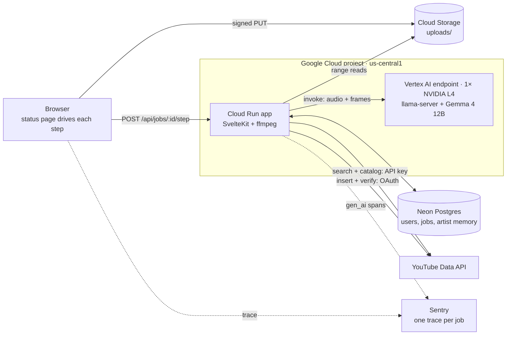

# 🎛️ Soundboard

Soundboard analyzes a finished music video and drafts its YouTube title, description, hashtags, and tags. The artist approves, edits, or re-runs the draft; on approval, Soundboard uploads the video as private and confirms the upload through the YouTube API.

[](https://soundboard.anchildress1.dev)
[](https://github.com/anchildress1/soundboard/actions/workflows/ci.yml)
[](https://github.com/anchildress1/soundboard/actions/workflows/codeql.yml)
[](https://sonarcloud.io/summary/new_code?id=anchildress1_soundboard)
[](LICENSE)


Built for [Flies Like Robots](https://www.youtube.com/@flieslikerobots) as an entry in the [DEV Hacktoberfest Weekend Challenge: Build for a Friend](https://dev.to/challenges/hacktoberfest-weekend-2026-10-01). Try it at [soundboard.anchildress1.dev](https://soundboard.anchildress1.dev), and read [the submission](https://dev.to/anchildress1/20-years-of-friendship-one-weekend-to-build-his-marketing-department-1bd).

<p align="center">
  
</p>

---

## Table of Contents

- [About](#about)
- [Features](#features)
- [Tech Stack](#tech-stack)
- [Architecture](#architecture)
- [Getting Started](#getting-started)
- [Configuration](#configuration)
- [Security](#security)
- [How to Contribute](#how-to-contribute)
- [License](#license)
- [Acknowledgements](#acknowledgements)
- [Author](#author)

---

## About

Nathan writes, records, and films his own music. Publishing each video still takes metadata work: a title, a description, tags, hashtags, consistency with the rest of the channel, and a check that the audio isn't clipping or dropping out.

Soundboard produces one complete draft of that metadata for Nathan to review, instead of a set of options to choose from.

The model is Gemma 4 12B-it, an open-weight model released by Google DeepMind under [Apache 2.0](https://huggingface.co/google/gemma-4-12B-it). It runs on a GPU in our own Google Cloud project, so unreleased audio is never sent to a third-party inference provider.

---

## Features

| Feature                  | Description                                                                                                                                                                                                             |
| ------------------------ | ----------------------------------------------------------------------------------------------------------------------------------------------------------------------------------------------------------------------- |
| Audio and video analysis | Each 29.5-second window of audio, plus 8 frames from it, is analyzed by Gemma                                                                                                                                           |
| Audio measurements       | Loudness, true peak, clipping, and silence are measured with ffmpeg, not estimated by the model                                                                                                                         |
| Upload checks            | "Check before uploading" lists only measured problems: ffmpeg's findings, the Short notice for vertical or square videos of 3 minutes or less, and problems a window analysis heard or saw. The model can't add its own |
| Metadata draft           | One title, description, hashtag set, and tag set, grounded in the most-viewed music videos for its genre                                                                                                                |
| Hashtag candidates       | Hashtags are chosen from a deterministic search of existing videos                                                                                                                                                      |
| Review                   | Edit any field, re-run for a new draft, or approve; edits and approvals inform later drafts                                                                                                                             |
| Verified upload          | Uploads as private, then reads the video back from the YouTube API before marking it verified                                                                                                                           |
| Metadata diff            | For an existing video, shows current and proposed metadata side by side with the reason for each change                                                                                                                 |
| Brand guide              | Reads the channel's 30 latest videos (up to 8 tags each, to fit the model's 8K context) and 10 thumbnails and proposes keep / fix / drop rules; once Nathan approves them, every draft for his channel follows them     |
| Short                    | Gemma picks the hook, ffmpeg's loudness places the cut, and ffmpeg fits it to 9:16 for review and the same private, verified upload; no generated frames                                                                |
| Tracing                  | One Sentry trace per job, with each Gemma call recorded as an AI agent span                                                                                                                                             |

---

## Tech Stack

| Layer         | Choice                                                                                                  |
| ------------- | ------------------------------------------------------------------------------------------------------- |
| App           | SvelteKit 2 + Svelte 5, TypeScript, Node 24                                                             |
| Model         | Gemma 4 12B-it, Google's official QAT Q4_0 GGUF + vision/audio projector, on `llama-server` (llama.cpp) |
| Media         | ffmpeg                                                                                                  |
| Hosting       | Cloud Run (app) + a Vertex AI endpoint with one NVIDIA L4 (model), us-central1                          |
| Data          | Neon Postgres (Drizzle), Cloud Storage, Secret Manager, Cloud KMS                                       |
| YouTube       | YouTube Data API v3                                                                                     |
| Observability | Sentry (AI agent tracing)                                                                               |
| Tooling       | pnpm, Vitest, Playwright, ESLint, Prettier, Lefthook, commitlint, Release Please                        |

---

## Architecture



- The app runs on Cloud Run with no GPU. The model runs on a Vertex AI dedicated endpoint, which the app calls with its service account. Both run at most one instance and scale to zero when idle; the first call to a sleeping model wakes it, and the page shows "waking model" until it answers.
- The model costs about $0.81/hour while its replica is up (`g2-standard-4` with the L4) and nothing while scaled to zero. A wake bills at least 5 minutes.
- The status page runs the pipeline one step per request (prep, one chunk at a time, then the draft; a Short adds a hook pick and a render). Reloading the page resumes from the next unfinished step.
- The full design is in [docs/prd.md](docs/prd.md).

---

## Getting Started

**Prerequisites:** [Volta](https://volta.sh) (pins Node and pnpm per project), ffmpeg, [gitleaks](https://github.com/gitleaks/gitleaks), [actionlint](https://github.com/rhysd/actionlint), and the `gcloud` CLI for deploys.

```bash
git clone git@github.com:anchildress1/soundboard.git
cd soundboard
cp .env.example .env   # fill in the values listed under Configuration
make install
pnpm drizzle-kit migrate
make dev
```

`drizzle-kit migrate` runs over `DATABASE_URL_UNPOOLED`: Neon's pooler can break migrations. Deploys run it too, before the new revision takes traffic.

| Command            | What it does                                                                                                  |
| ------------------ | ------------------------------------------------------------------------------------------------------------- |
| `make dev`         | Start the dev server                                                                                          |
| `make ai-checks`   | Format, lint, typecheck, test, build                                                                          |
| `make e2e`         | Playwright end-to-end tests                                                                                   |
| `make deploy`      | Deploy the model endpoint if its image changed, then build and deploy the app (requires a clean working tree) |
| `make model-image` | Build the Gemma 4 model image on Cloud Build, tagged by the `model/` tree; skipped if already built           |

### Operating it

- **Production database:** provision two secrets from Neon's `main` branch:
  - `DATABASE_URL`: pooled URL for the restricted `soundboard_app` login.
  - `DATABASE_URL_UNPOOLED`: owner's direct URL for migrations and operator commands.

  Replace `YOUR_GCP_PROJECT_ID`; for each command, paste the corresponding URL on standard input and press Ctrl-D:

  ```bash
  gcloud secrets create DATABASE_URL --project=YOUR_GCP_PROJECT_ID --replication-policy=automatic --data-file=-
  gcloud secrets create DATABASE_URL_UNPOOLED --project=YOUR_GCP_PROJECT_ID --replication-policy=automatic --data-file=-
  ```

  `deploy.sh` requires both secrets and grants the owner secret only to the deployer.

  Never derive the owner credential from the app URL or grant the runtime access to the owner secret.

  See [database roles and the deployment freeze](docs/operations/youtube-retention.md#database-roles).

- **Invites:** while `SIGNUP_MODE=invite`, only invited emails can sign in. Manage them with `node --env-file=.env scripts/invite.ts add <email> [--artist flr]`, `revoke <email>`, `reactivate <email>`, or `list`. Locally, the script uses the dev owner's `DATABASE_URL_UNPOOLED` from `.env`; production commands use the owner secret explicitly:

  ```bash
  DATABASE_URL_UNPOOLED="$(gcloud secrets versions access latest --secret=DATABASE_URL_UNPOOLED --project=YOUR_GCP_PROJECT_ID)" node scripts/invite.ts list
  ```

  Replace `YOUR_GCP_PROJECT_ID` and use the same prefix for `add`, `revoke`, or `reactivate`. `--artist flr` links the account to Nathan's artist profile. Revoking signs the user out on their next request.

- **Connections:** signing in also connects the user's own YouTube channel. The _Connections_ page shows its status and offers Reconnect and Disconnect; a missing or revoked grant blocks approval until it's reconnected. Refresh tokens are stored encrypted with the Cloud KMS key.
- **Genre research retention:** database reads exclude research at least 30 days old. Deploy and enable the daily Neon cleanup separately using [the retention procedure](docs/operations/youtube-retention.md); an app deployment alone does not create that schedule.
- **OAuth consent screen:** set it to _In production_ before connecting; Testing-mode refresh tokens expire after 7 days. Add `https://soundboard.anchildress1.dev/auth/callback` and `<run.app service URL>/auth/callback` as redirect URIs: sign-in redirects back to whichever origin the user signed in from.
- **Brand guide:** accounts linked to Nathan's artist profile get a _Brand guide_ link to `/brand`. _Propose_ reads the latest uploads; edit the statement and rules, then _Approve_. Drafts for Nathan's channel follow the approved guide; other users' drafts never read it.
- **Model deploys:** run `make model-image` first, then `make deploy`. The first deploy uploads that image to Vertex and deploys it to the endpoint; expect 20+ minutes. Vertex can fail a deploy with a generic system error when no L4 is free in us-central1. `make deploy` refuses to queue a second deploy while one is still running, and uses the image tagged for the current `model/` tree. A model left idle for 30 days is undeployed automatically; `make deploy` puts it back.

---

## Configuration

Values live in `.env` for local development and in Secret Manager or Cloud Run environment variables when deployed. Do not commit real values.

| Variable                                                | Purpose                                                                                          |
| ------------------------------------------------------- | ------------------------------------------------------------------------------------------------ |
| `GCP_PROJECT_ID`                                        | Project that hosts the service, bucket, and KMS key                                              |
| `GCS_BUCKET`                                            | Bucket for uploads (`uploads/`, deleted after 7 days)                                            |
| `MODEL_URL`                                             | `llama-server` base URL for local development; `deploy.sh` sets the Vertex endpoint's invoke URL |
| `YOUTUBE_API_KEY`                                       | Read-only key from a second GCP project, used for search and catalog reads                       |
| `FLR_CHANNEL_ID`                                        | The Flies Like Robots channel ID                                                                 |
| `GOOGLE_OAUTH_CLIENT_ID` / `GOOGLE_OAUTH_CLIENT_SECRET` | Google sign-in and YouTube upload authorization                                                  |
| `SIGNUP_MODE`                                           | `invite` (default): invited emails only. `open`: any Google account                              |
| `KMS_KEY`                                               | Cloud KMS key that encrypts refresh tokens; `deploy.sh` creates it and sets this for the service |
| `DATABASE_URL`                                          | Neon pooled URL for the restricted `soundboard_app` login; locally, a dev branch (never `main`)  |
| `DATABASE_URL_UNPOOLED`                                 | Neon owner's direct URL for migrations and operator invites; never supplied to the app runtime   |
| `SESSION_SECRET`                                        | Signs the sign-in session cookie                                                                 |
| `PUBLIC_SENTRY_DSN`                                     | Sentry DSN (public by design)                                                                    |
| `SENTRY_AUTH_TOKEN` (in `.env.sentry-build-plugin`)     | Optional. Lets deploys upload source maps; stored in Secret Manager for Cloud Build only         |

---

## Security

- Video and audio are stored only in Cloud Storage and processed only by the model running on a Vertex AI endpoint in the same project. Sentry receives text, with audio and images replaced by size-only placeholders.
- Every page except home and the sign-in pages, and every API, needs a signed-in Google account (an invited one while `SIGNUP_MODE=invite`). Each user sees and uploads only their own jobs, to their own channel; only accounts linked to Nathan's artist profile read or change his stored preferences.
- Secrets live in Secret Manager or a local `.env`. YouTube refresh tokens stay on the server, encrypted with a Cloud KMS key only the app's service account can use.
- No client access to the database: only the app, migrations, and the invite script connect, using connection strings from Secret Manager or a local `.env`.
- Upload URLs are size-capped, and uploaded files are deleted after 7 days.

---

## How to Contribute

Issues and pull requests are welcome.

- Branch from `main` and open a pull request; `main` is not committed to directly.
- Use [Conventional Commits](https://www.conventionalcommits.org), GPG-signed, with an AI attribution footer and `Signed-off-by`. commitlint and [rai-lint](https://github.com/anchildress1/rai-lint) enforce this.
- Run `make ai-checks` before pushing.

---

## License

This repository's code is source-available under the [PolyForm Noncommercial License 1.0.0](LICENSE). It is not open source. You may read, run, modify, and share it for any noncommercial purpose, such as personal study, hobby projects, or research with no commercial application. Charities, schools, public research, safety, health, and environmental organizations, and government bodies may use it however they are funded. Other commercial use, including running it to grow a monetized channel, selling it, or offering it as a hosted service, needs separate written permission.

Artists can email [anchildress1@gmail.com](mailto:anchildress1@gmail.com) to ask for permission to run their own copy, or for an invite to test the hosted version.

Releases up to and including v1.0.0 were published under MIT and stay MIT. The PolyForm terms apply to everything after that release.

Gemma 4's model weights are not part of this repository. Google DeepMind distributes them separately under [Apache 2.0](https://huggingface.co/google/gemma-4-12B-it-qat-q4_0-gguf).

---

## Acknowledgements

- **Nathan (Flies Like Robots)**, for the music and for being the first user.
- **DEV** and **MLH**, for running the Hacktoberfest Weekend Challenge that prompted this build.
- **Google DeepMind** for Gemma, and the **llama.cpp** maintainers for `llama-server`.

---

## Author

**Ashley Childress** — [@anchildress1](https://github.com/anchildress1) · [dev.to/anchildress1](https://dev.to/anchildress1)
