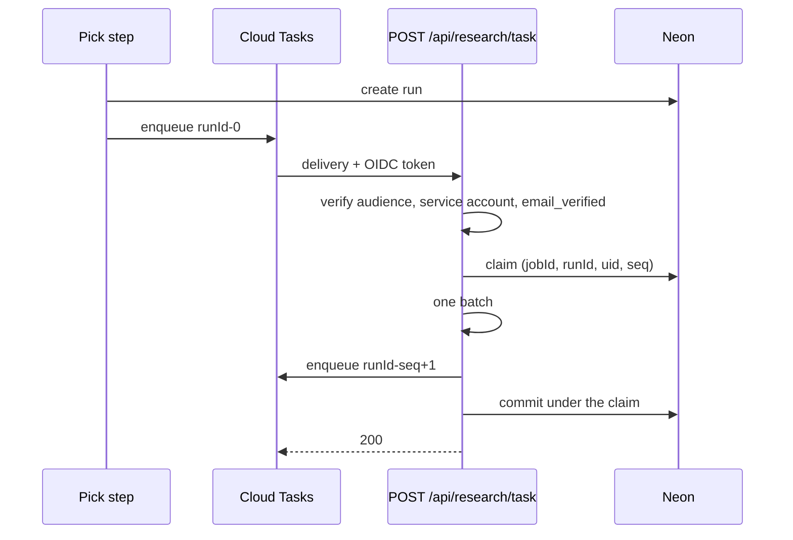

# Research runner

Research and learning run as Cloud Tasks deliveries: each one is an ordinary request to the app, so nothing runs in the background and nothing runs without work.

## How a run works

- The first `PICK` step of an artist's release creates a `research_runs` row (stage `learn`), enqueues the first task and returns the wait "Researching similar artists". Page loads never start a run.
- Each task is `POST /api/research/task` with `{ jobId, uid, runId, seq }`, named `<runId>-<seq>` so a retried enqueue is deduplicated.
- A delivery claims the run with one conditional update (3-minute claim), does one batch of its stage under the 110 s step budget, enqueues `seq + 1` (delayed when it hit a wait), then commits.
- Stages in order: `learn`, `discover`, `match`, `releases`, then `done`. A stage repeats, batch by batch, until its items are finished.
- The pick proceeds when the run is `done` or `failed`, or 10 minutes after it started. A research failure never fails the release; the draft says what was missing.



## Responses

| Status | Meaning                                                                                   |
| ------ | ----------------------------------------------------------------------------------------- |
| `200`  | A batch committed, or the delivery was stale (finished, discarded, replaced, lower `seq`) |
| `503`  | The claim is held, or `seq` is ahead of the row; Cloud Tasks retries with backoff         |
| `500`  | The next enqueue failed; nothing was written, so the redelivery starts clean              |
| `401`  | Missing or wrong OIDC token; nothing was read                                             |
| `400`  | Body has the wrong shape                                                                  |

The body never carries run contents, evidence, tokens or errors.

## Configuration

`deploy.sh` does all of this; nothing here is applied by hand.

- Queue `soundboard-research` in `us-central1`: `--max-concurrent-dispatches 1 --max-attempts 20 --min-backoff 10s --max-backoff 300s --max-retry-duration 3600s`. Tasks use a 180 s dispatch deadline, under the claim.
- Environment: `RESEARCH_QUEUE` (the queue's full name), `RESEARCH_TASK_URL` (`https://soundboard-<project number>.us-central1.run.app/api/research/task`, which Cloud Run knows before the first deploy), `RESEARCH_TASK_SA` (the runtime service account). All three or none. With none, dev runs deliveries in the app process and a build throws.
- The service is public (`allUsers` invoker), so the handler verifies the token itself: audience `RESEARCH_TASK_URL`, email `RESEARCH_TASK_SA`, `email_verified`.
- IAM: the runtime service account is `roles/cloudtasks.enqueuer` on the queue, and `roles/iam.serviceAccountUser` on itself, granted to itself and to the Cloud Tasks service agent.
- APIs: `cloudtasks.googleapis.com` and `youtubeanalytics.googleapis.com`.
- `PEER_HEARING=1` lets Gemini hear a peer's public upload by URL (gate G1 passed). Unset, every match is metadata-only and labeled so.

## Reading a stuck run

Run state has no YouTube data, so an operator can read it with the owner credential:

```sql
select stage, seq, cursor, wait, error, limits, consecutive_failures, claim_until, updated_at
from research_runs where job_id = '<job id>';
```

| What you see                                         | Meaning                                                                 |
| ---------------------------------------------------- | ----------------------------------------------------------------------- |
| `wait` set, stage unchanged                          | Provider busy, a spent quota or a short step; the next task is delayed  |
| `stage = 'failed'`, `error = 'research-unavailable'` | The enqueue failed; the draft went ahead without peers                  |
| `stage = 'failed'`, `error = 'discarded'`            | The job was discarded                                                   |
| `stage = 'failed'`, another error                    | Two failed batches in a row                                             |
| `claim_until` in the past, stage unchanged           | A delivery died mid-batch; the retry claims it after the claim expires  |
| `seq` behind the Cloud Tasks queue                   | Look for a 503 loop in the queue logs; the earlier task never committed |

A failed run is terminal during ordinary polling. Only an explicit re-run of the release replaces it.

## One-time setup of a separate environment

`anchildress1-unstable` is the whole spec 006 environment: its own service, queue, runtime identity, key, bucket, secrets, OAuth client and Neon branch. Production is untouched until the owner promotes the code. `deploy.sh` is never run by an agent, and every deployment needs explicit operator authorization.

1. In the project: a runtime service account `soundboard`, the KMS key ring `soundboard` with key `refresh-tokens`, and the uploads bucket. `deploy.sh` creates all three when they are missing.
2. Secrets `soundboard-session-secret`, `soundboard-oauth-client-secret`, `soundboard-youtube-api-key`, `soundboard-gemini-api-key` and `DATABASE_URL` and `DATABASE_URL_UNPOOLED`, the last two pointing at the unstable Neon branch. `deploy.sh` reads the first four from `.env`.
3. A Google OAuth client for the project. Add `<service URL>/auth/callback` as a redirect URI, and add `https://www.googleapis.com/auth/yt-analytics.readonly` to Data Access.
4. Deploy with `GCP_PROJECT_ID=anchildress1-unstable APP_DOMAIN=<service URL> ./deploy.sh`.
5. Deploy and schedule `genrecleanup` on the unstable Neon branch, as in [the retention procedure](youtube-retention.md).
6. Verify: a forged `POST /api/research/task` without a token returns `401`; one release with the browser closed after Listening shows deliveries in the Cloud Tasks logs ending in `200`.
