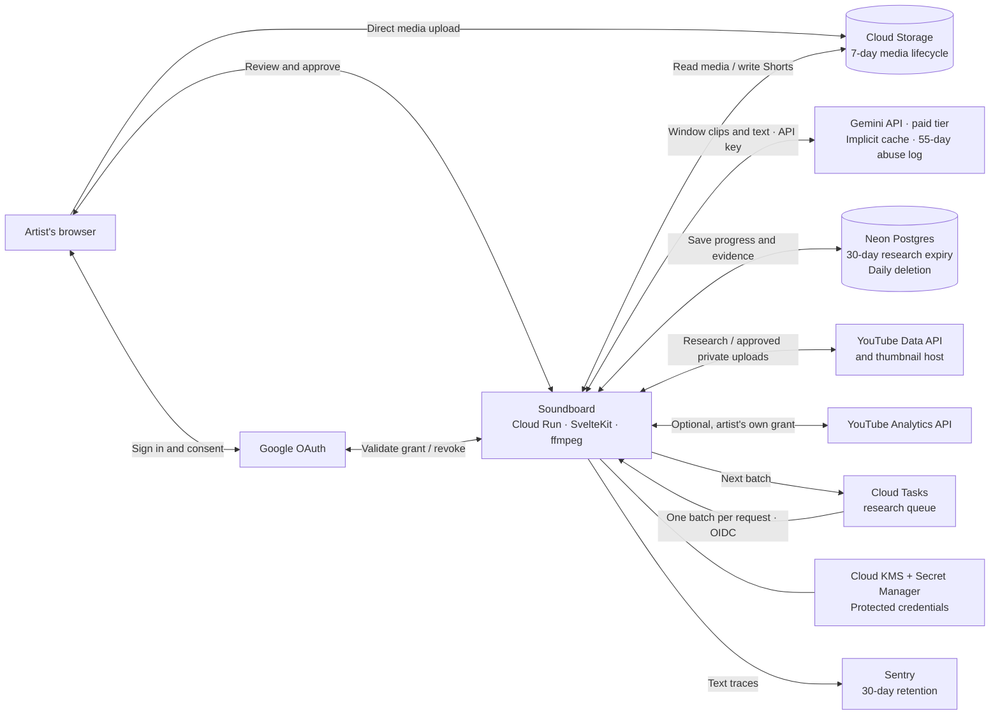

# YouTube audit architecture

## Current implementation

This describes the repository implementation, not confirmation that every component is deployed.

- Public research uses an API key; own-channel confirmation and uploads use the artist's OAuth grant.
- Each source video supplies a separate candidate list; terms are unique within that video.
- Research terms are never counted or weighted across videos or channels; raw view counts do not enter model prompts.
- Uploads use the approving artist's pinned channel and remain private; only API read-back marks them verified.
- Gemini receives each analysis window as a clip of at most 640×360 and 8,000,000 bytes, sent inline and never as a link, plus song details, notes and YouTube metadata. Calls use the paid tier, so Google doesn't use the content to improve its products.
- Every call sets `store: false`, which turns off stored interaction history only. Gemini may also cache parts of a request automatically; Google publishes no expiry for those copies. Separately, Google keeps requests and responses up to 55 days for abuse monitoring, where authorized staff may review flagged requests. A deletion request to Soundboard can't reach either copy.
- Model-call traces record full prompt, reply and reasoning text for every agent, including YouTube titles, descriptions and tags. Sentry keeps them for 30 days on the Developer plan. Media bytes are replaced with placeholders and URL credentials are removed. Voice and brand guide replies are recorded only as their length, and the uploads sent to them only as a count.
- Approval gate: the Gemini version isn't deployed until YouTube approves the request covering this Gemini processing and storage and the Sentry text retention.
- Thumbnails are fetched from YouTube's image host only for smart pick and the brand guide, sent to the model, and not stored.
- Voice and brand proposals read the artist's own uploads through the artist's own grant, never through the API key or another account's grant. A pending proposal stores its rules and the list of uploads it read (video ID, title, publish date), never descriptions or statistics.
- The database hides a proposal 29 days after its claim, the daily cleanup deletes it, and Disconnect deletes every pending proposal of that user's artist.
- Approval keeps the rules as the artist's own statement, per the owner's reading of III.E.4.h, with a source summary of counts only; the upload list is dropped.
- Header channel stats are cached in memory only and never written to the database.
- The daily cleanup function runs at 03:00 UTC on the production database branch, deployed on 2026-10-24. It rejects any call that doesn't come from Neon's scheduler and can only delete research that is already past 30 days.

## Fanbase learning (spec 006)

- Research and learning run server-side through one Cloud Tasks queue. Each delivery is a request to the app that runs one claimed batch of a stage (learn, discover, match, releases) and enqueues the next. The queue carries run identifiers only, never YouTube data. Nothing runs without work.
- Peer research uses the API key: a genre search by relevance, then public channel and upload reads. Each peer is an individual, labeled example. Peers are placed in subscriber-count ranges that use the same boundaries as the artist's own; channels more than two ranges up, and channels that hide their count, are not used.
- Each peer release keeps its own candidate list. Nothing is summed, averaged, counted or weighted across videos or channels, and there is no combined score.
- Peer data (channels, releases, statistics as reported) is Non-Authorized API data. It carries its retrieval time, is hidden by the database at 29 days and deleted by the daily cleanup. A draft keeps only an internal reference to a peer; once the evidence expires the review says so and shows the date.
- Analytics is an optional second grant (`yt-analytics.readonly`), requested only when the artist chooses Share analytics. It reads the first 28 days of totals for the artist's own public uploads. Results are Authorized Data: refreshed on each run, hidden at 29 days, deleted daily, and deleted at once when the artist disconnects, revokes, or reconnects without the scope. A report that was in flight when sharing ended cannot be saved.
- Numbers on screen are either exactly as YouTube returned them or calculated in code from stored data and labeled "calculated". The model is told never to write a number about views, subscribers or engagement, and a server check removes any sentence that does.
- Gemini may hear a 60-second clip of a peer's public upload through its YouTube URL; the app does not download it. The artist's own media is never sent as a link.
- Sentry keeps prompt and reply text for the peer-matching and smart-pick agents. Values drawn from YouTube data (numbers, peer titles, channel names, peer text) are replaced with a placeholder in prompts and replies.
- Retention changes: the daily cleanup also deletes expired peer research, analytics results and peer rejections.
