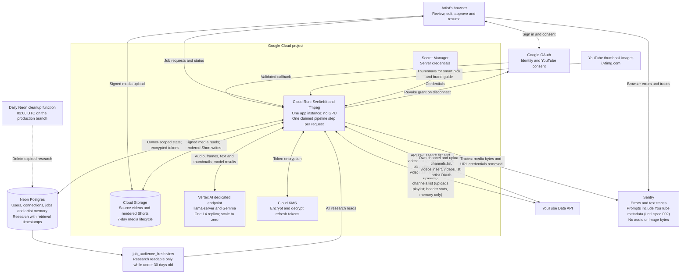
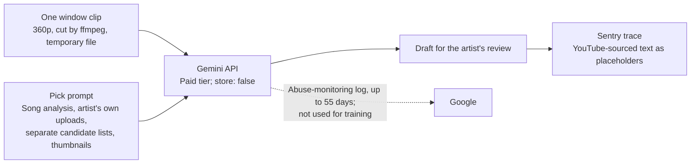
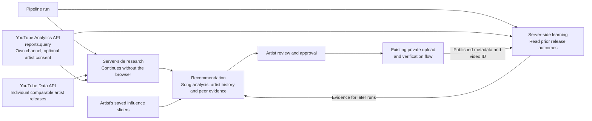

# YouTube audit architecture

## Current implementation

This describes the repository implementation, not confirmation that every component is deployed.

- Each source video supplies a separate candidate list; terms are unique within that video.
- Research terms are never counted or weighted across videos or channels; raw view counts do not enter model prompts.
- Uploads use the approving artist's pinned channel and remain private; only API read-back marks them verified.
- Model-call traces currently record full prompt text, which includes YouTube titles, descriptions and tags. Media bytes and URL credentials are removed. Spec 002 replaces YouTube-sourced text in traces with placeholders.
- Thumbnails are fetched from YouTube's image host only for smart pick and the brand guide, sent to the model, and not stored.
- Header channel stats are cached in memory only and never written to the database.
- The daily cleanup function runs at 03:00 UTC on the production database branch, deployed on 2026-10-24. It rejects any call that doesn't come from Neon's scheduler and can only delete research that is already past 30 days.

## Planned model provider: Gemini API (spec 002)

Not implemented. Replaces the self-hosted Gemma endpoint.

- YouTube API data is used per call only. The app requests no provider storage, caching, file uploads or grounding.
- The artist's own channel data serves only that artist's requests.
- The privacy policy names the Gemini API as a processor when this ships.

## Planned fanbase learning — spec 006

These stages are not implemented; calculated metrics and subscriber-range targeting remain disabled until YouTube accepts the amendment.

- Peer releases stay individually labeled; no cross-owner totals or combined performance score.
- Reported statistics retain retrieval times and database-enforced 30-day expiry.
- Views indicate reach; only the artist's authorized subscriber gains and losses measure fanbase change.
