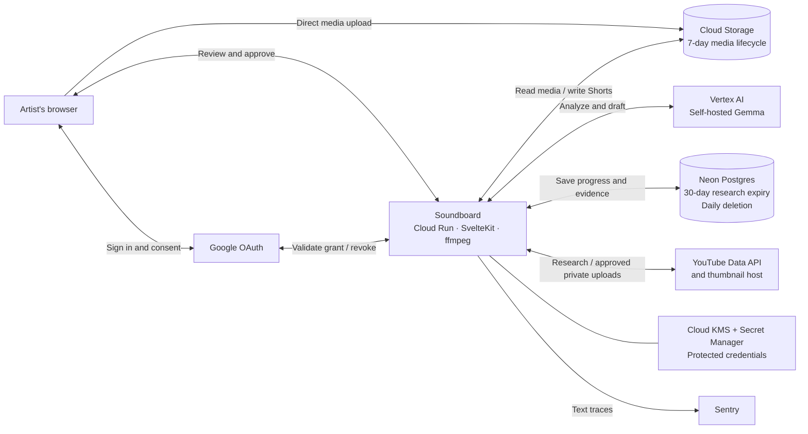

# YouTube audit architecture

## Current implementation

This describes the repository implementation, not confirmation that every component is deployed.

- Public research uses an API key; own-channel confirmation and uploads use the artist's OAuth grant.
- Each source video supplies a separate candidate list; terms are unique within that video.
- Research terms are never counted or weighted across videos or channels; raw view counts do not enter model prompts.
- Uploads use the approving artist's pinned channel and remain private; only API read-back marks them verified.
- Model-call traces currently record full prompt text, which includes YouTube titles, descriptions and tags. Media bytes and URL credentials are removed. Spec 002 replaces YouTube-sourced text in traces with placeholders.
- Thumbnails are fetched from YouTube's image host only for smart pick and the brand guide, sent to the model, and not stored.
- Header channel stats are cached in memory only and never written to the database.
- The daily cleanup function runs at 03:00 UTC on the production database branch, deployed on 2026-10-24. It rejects any call that doesn't come from Neon's scheduler and can only delete research that is already past 30 days.

## Planned model provider — spec 002

- Not implemented: replace self-hosted Gemma with the paid Gemini API for analysis and drafting.
- Use per-call inputs with provider storage disabled; disclose Google's abuse-monitoring retention and replace YouTube-sourced text in Sentry with placeholders.

## Planned fanbase learning — spec 006

- Not implemented: pipeline-run research and learning from individual comparable releases and optional artist-authorized YouTube Analytics, guided by saved influence sliders.
- Calculated metrics and subscriber-range targeting stay disabled until YouTube accepts the amendment; retain 30-day statistics expiry and no cross-owner totals.
