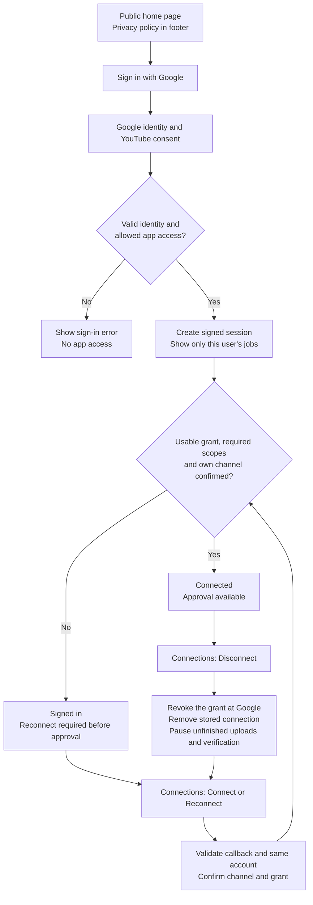
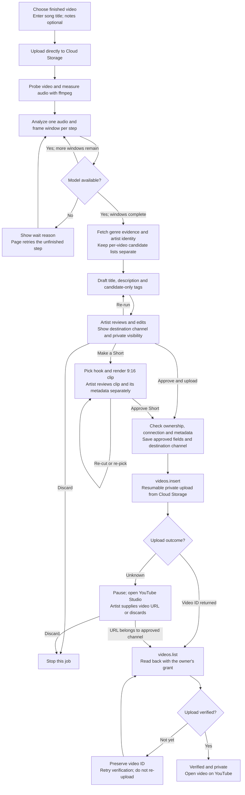

# YouTube audit user flows

These diagrams describe the current repository implementation.

## Sign-in and YouTube connection

## Analyze, review and upload

- Reloading resumes saved progress; the page must remain open to drive current pipeline steps.
- Lost or revoked YouTube access pauses publishing until the same channel reconnects.
- Upload verification does not make a video public; the artist controls publication in YouTube.
- Bandcamp copy is available to copy and paste; Soundboard does not post it.
