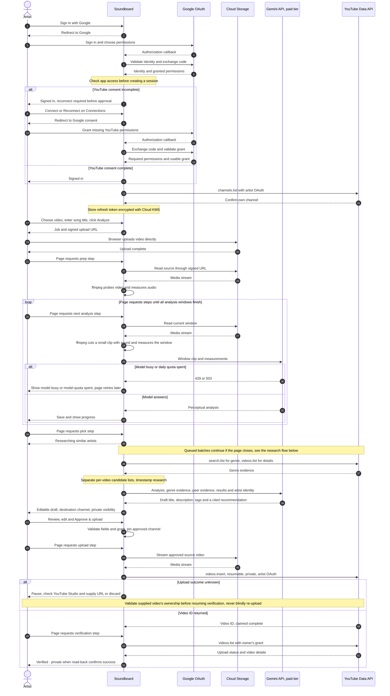
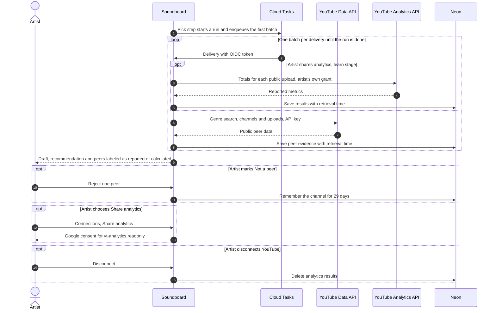

# YouTube audit user flow

Current implementation: sign-in through private upload verification.

- The page drives steps; reload resumes saved progress.
- A Short requires its own review and approval, then uses the same private upload and read-back flow.

## Research and learning

- Sharing analytics is optional and separate from sign-in; the draft and approval work without it.
- Peer data and analytics results are hidden after 29 days and deleted daily.
- Peers are individual examples; no totals or combined scores are shown.
