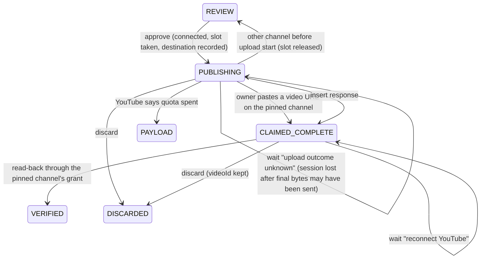

# Data Model: Google Sign-In and Connections

All Firestore. Client access stays denied by rules; only the app's service account reads and writes.

## `users/{sub}`

| Field              | Type           | Rule                                                                                            |
| ------------------ | -------------- | ----------------------------------------------------------------------------------------------- |
| `email`            | string         | From the latest verified ID token; display only                                                 |
| `name`             | string \| null | From the ID token                                                                               |
| `inviteEmail`      | string \| null | Normalized email of the invite this user redeemed; null in open signup                          |
| `artistId`         | string \| null | `'flr'` for Nathan until spec 002; copied from the invite at first redemption                   |
| `accessGeneration` | number         | Starts at 1. Revoking the invite increments it. Sessions carrying an older value are signed out |
| `createdAt`        | number         | ms                                                                                              |

- Created only after the invite check passes (FR-005). An uninvited sign-in writes nothing.
- Sign-in looks up `users/{sub}` first and checks the invite named by its `inviteEmail`, so an email change keeps access. Only a first sign-in looks the invite up by the token's email.
- `accessGeneration` is written only at creation and by revoke. Sign-in upserts never touch it, so re-inviting never revives an old cookie.

## `users/{sub}/connections/youtube`

| Field             | Type                                                           | Rule                                                         |
| ----------------- | -------------------------------------------------------------- | ------------------------------------------------------------ |
| `status`          | `'connected' \| 'missing_scopes' \| 'no_channel' \| 'revoked'` | `connected` only per FR-027                                  |
| `channelId`       | string \| null                                                 | From `channels.list?mine=true` through this grant            |
| `channelTitle`    | string \| null                                                 | Same call                                                    |
| `scopes`          | string[]                                                       | Granted scopes from the token response                       |
| `tokenCiphertext` | string \| null                                                 | KMS-encrypted refresh token, base64. Null unless `connected` |
| `updatedAt`       | number                                                         | ms                                                           |

- One per user (FR-014). Connecting another channel overwrites it in a single write, only after the new grant validates (FR-027).
- `revoked` is set when Google returns `invalid_grant`, and the ciphertext is cleared in the same write. A dead token is never kept.
- Disconnect: revoke at Google, then delete the doc.

## `invites/{normalizedEmail}`

| Field       | Type           | Rule                                                                                  |
| ----------- | -------------- | ------------------------------------------------------------------------------------- |
| `email`     | string         | Lowercased, trimmed                                                                   |
| `active`    | boolean        | `false` = revoked                                                                     |
| `artistId`  | string \| null | Copied to the user on first redemption                                                |
| `boundSub`  | string \| null | Set atomically on first redemption. Only this `sub` may redeem it afterwards (FR-005) |
| `createdAt` | number         | ms                                                                                    |

- Revoke and reinvite run through `scripts/invite.ts`. Revoking sets `active: false` and increments the bound user's `accessGeneration` in one transaction (FR-006).

## `jobs/{id}` (changed fields)

| Field                               | Change                                                                                                                                                                                                               |
| ----------------------------------- | -------------------------------------------------------------------------------------------------------------------------------------------------------------------------------------------------------------------- |
| `ownerUid`                          | **New.** `sub` of the creator. Every page and API returns 404 to anyone else (FR-012)                                                                                                                                |
| `artistId`                          | **New.** Owner's artist link at create, nullable. Until spec 002, a pick reads or writes `artists/flr` only when this and the owner's current `artistId` both equal `flr`; otherwise it runs with no memory (FR-018) |
| `destination`                       | **New.** `{channelId, channelTitle} \| null`, set at approval (FR-022)                                                                                                                                               |
| `parentId`                          | **New top-level.** `null` on videos, the parent's ID on Shorts. Today it only exists nested in `short.parentId`, and Firestore's `== null` skips docs without the field                                              |
| `uploadStartedAt`                   | **New.** ms timestamp or null. Persisted before the first external upload-initiation request; never cleared by session expiry, retry or reconnect                                                                    |
| `finalChunkAt`                      | **New.** ms timestamp or null. Persisted before sending the chunk that reaches the file size. Top-level, because Retry and session loss reset `job.upload`; nothing clears it                                        |
| `uploadSlotDay`                     | **New.** The quota day the approval's slot was taken from. A release decrements that day only                                                                                                                        |
| `owner`                             | **Removed** (`nathan` / `demo` / `visitor`)                                                                                                                                                                          |
| `channel`                           | **Removed** (`nathan` / `sandbox`)                                                                                                                                                                                   |
| `sampleId`, `liveVideoId`, `ipHash` | **Removed**                                                                                                                                                                                                          |

- Shorts copy `ownerUid`, `artistId` and `destination: null` from their parent.
- Migration of existing `PUBLISHING` and `CLAIMED_COMPLETE` jobs:
  - `destination` = FLR's channel.
  - `uploadStartedAt` set when an upload session or video ID exists.
  - `finalChunkAt` set on any started job without a video ID, so its outcome goes through the uploads check instead of a blind restart.
  - `parentId` written on every job.
- New composite index for the home job list (FR-029): `ownerUid ==`, `parentId == null`, `createdAt desc`. The E2E fake Firestore gains `where()` and `orderBy()` so the query is exercised.
- A step result that lands after the job moved (for example a discard during the final chunk) still saves `videoId` and upload progress. Today `releaseJob` drops the whole patch (`jobs.ts:151-153`).

### Publishing and verification with a pinned destination

- "Upload start" means `uploadStartedAt` is set durably before sending the first upload-initiation request. Only while it is null may a channel mismatch return the job to `REVIEW`, clear `destination` and release the reserved slot. Clearing or replacing `job.upload` never clears this marker or unlocks the destination.
- Session PUTs carry no `Authorization` header; the session URI is the credential (`youtube.ts:248-286`). So each upload step first checks the pinned channel's connection doc is `connected`, and waits "reconnect YouTube" otherwise. Revoking at Google alone does not stop a live session.
- A status check returning complete keeps the video ID and verifies; returning incomplete resumes from its offset.
- A 404 with `finalChunkAt` null starts a fresh session on the pinned destination with the same slot. With it set, completion is unknown:
  - The step returns wait "upload outcome unknown" with a link to the channel's uploads in YouTube Studio. It makes no YouTube call, so the page's polling costs no quota.
  - The owner pastes the video's URL. The app reads it through the pinned grant and requires the pinned `channelId`; then it records the ID, moves to `CLAIMED_COMPLETE` and runs normal read-back.
  - Without confirmation, the job stays paused and the owner may discard it. Discard does not prove the upload failed or remove any video already created.
- Waits are step wait reasons, like "waking model". They are not new states, and they never count as failures.
- `PAYLOAD` is kept only for YouTube's own quota-spent response. The visitor and "not connected" uses of it are removed.

## `quota/{day}` (changed)

| Field                           | Change                                       |
| ------------------------------- | -------------------------------------------- |
| `uploads`                       | Kept: one shared pool, `UPLOADS_PER_DAY = 6` |
| `runs`, `ips`, `visitorUploads` | **Removed**                                  |

- A fresh session on a later day than `uploadSlotDay` reserves a slot on the current day, because YouTube charges the day the insert happens.

## Session cookie `sb_session`

- Payload `{uid, sid, gen, exp}`, HMAC-signed with `SESSION_SECRET` (existing `sign` / `unsign`). `sid` is a random ID per sign-in, so each browser session is distinct.
- `exp` is the sign-in time plus 30 days, fixed.
- Valid only when the signature checks out, `exp > now`, `users/{uid}` exists and `gen === accessGeneration`. One Firestore read; revocation works through the generation bump, so no invite read per request.
- A legacy `{email, exp}` cookie has no `uid`, so it fails the check (FR-031).

## OAuth state cookie `sb_oauth`

- Payload `{nonce, purpose: 'sign-in' | 'connect', uid: string | null, sid: string | null, exp}`, where `exp` is 10 minutes out. Path `/auth`.
- On `connect`, the callback requires the current session's `uid` and `sid` to both match the state (FR-026). Signing out and back in gets a new `sid`, so a stale callback fails.
- The cookie is deleted on first read, so a replay fails. Logout deletes it too.

## Removed collections

- `samples` is removed. Its docs and `samples/` GCS objects are deleted by hand after cutover.
- Legacy `visitor` and `demo` job docs are deleted by the migration script; their media goes with the existing 7-day GCS rule.
