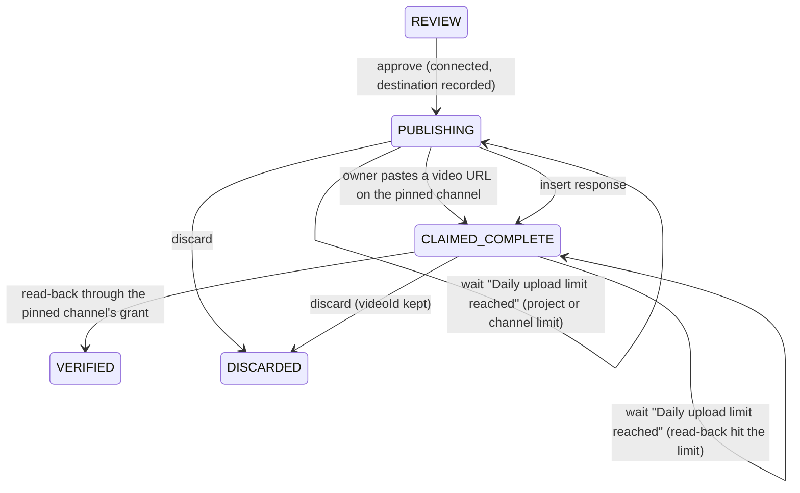

# Data Model: Google Sign-In and Connections

Neon Postgres, through Drizzle (research R12). The schema lives in `src/lib/server/core/schema.ts`; `drizzle-kit` generates the SQL migrations in `drizzle/`. Only the app's connection string reaches the database. Times are `timestamptz`; columns are snake_case in SQL and camelCase in TypeScript.

Nothing is carried over from Firestore (pre-beta). The FLR artist memory starts from `SEED_FACTS`, and the brand guide is proposed again.

## `users`

The allowlist and the accounts are one table: the operator adds an email by hand, and its first Google sign-in binds the account.

| Column       | Type                                 | Rule                                                                   |
| ------------ | ------------------------------------ | ---------------------------------------------------------------------- |
| `email`      | text, primary key                    | Lowercased, trimmed; the invited email, and the display email          |
| `uid`        | text, unique                         | The Google `sub`. Null until the first sign-in; never rebound (FR-005) |
| `artist_id`  | text                                 | `'flr'` for Nathan until spec 002                                      |
| `active`     | boolean, not null, default true      | `false` = revoked: every session fails on its next request (FR-006)    |
| `created_at` | timestamptz, not null, default now() |                                                                        |

- Sign-in admits an active row bound to the token's `sub`, so an email change keeps access. A first sign-in binds with `UPDATE users SET uid = $sub WHERE email = $email AND active AND (uid IS NULL OR uid = $sub)`; zero rows means denied, and nothing is written.
- Open signup inserts a row for an unknown email first, then binds it the same way. Those rows stay on the allowlist: switching back to invite mode keeps them signed in until each is revoked.
- `scripts/invite.ts` adds, revokes (`active = false`), reactivates and lists rows.

## `connections`

| Column             | Type                                                                   | Rule                                                         |
| ------------------ | ---------------------------------------------------------------------- | ------------------------------------------------------------ |
| `uid`              | text → `users.uid` on delete cascade                                   | Primary key: one YouTube connection per user                 |
| `status`           | text, check `in ('connected','missing_scopes','no_channel','revoked')` | `connected` only per FR-027                                  |
| `channel_id`       | text                                                                   | From `channels.list?mine=true` through this grant            |
| `channel_title`    | text                                                                   | Same call                                                    |
| `scopes`           | text[], not null                                                       | Granted scopes from the token response                       |
| `token_ciphertext` | text, check `(status = 'connected') = (token_ciphertext is not null)`  | KMS-encrypted refresh token, base64. Null unless `connected` |
| `updated_at`       | timestamptz, not null                                                  |                                                              |

- One per user (FR-014); a `connected` row always names a channel, always on the user's own Google account. Reconnect upserts the row in one statement, only after the new grant validates and its ID token `sub` equals the user's (FR-023, FR-027).
- `revoked` is set when Google returns `invalid_grant` or YouTube refuses the access token (401) during publish, verify, or confirm-upload, and the ciphertext is cleared in the same `UPDATE`. A dead token is never kept.
- Disconnect: revoke at Google, then delete the row.

## `jobs`

Fields the app filters or locks on are columns; the rest of today's job document (analysis, recommendation, approved fields, upload session, Short settings) stays one `data` jsonb column, so the pipeline code keeps its shapes.

| Column                   | Type                         | Rule                                                                                                                                                          |
| ------------------------ | ---------------------------- | ------------------------------------------------------------------------------------------------------------------------------------------------------------- |
| `id`                     | text, primary key            | Today's job ID format                                                                                                                                         |
| `owner_uid`              | text → `users.uid`, not null | Every page and API returns 404 to anyone else (FR-012)                                                                                                        |
| `artist_id`              | text                         | Owner's artist link at create. Until spec 002, a pick reads or writes FLR memory only when this and the owner's current `artist_id` both equal `flr` (FR-018) |
| `parent_id`              | text → `jobs.id`             | Null on videos, the parent's ID on Shorts                                                                                                                     |
| `state`                  | text, not null               | Today's states                                                                                                                                                |
| `created_at`             | timestamptz, not null        |                                                                                                                                                               |
| `claim_until`            | timestamptz                  | Step claim, 3 minutes out                                                                                                                                     |
| `claim_token`            | text                         | Fresh random token per claim; only its holder may save step results or release the claim                                                                      |
| `destination_channel_id` | text                         | Set at approval (FR-022), with `destination_channel_title`                                                                                                    |
| `upload_started_at`      | timestamptz                  | Persisted before the first external upload-initiation request; never cleared by session expiry, retry or reconnect                                            |
| `final_chunk_at`         | timestamptz                  | Persisted before sending the chunk that reaches the file size. A column, because session loss resets the upload session in `data`; nothing clears it          |
| `video_id`               | text                         | Kept on every later state change, including discard                                                                                                           |
| `data`                   | jsonb, not null              | Everything else on today's job document, minus the removed fields below                                                                                       |
| `picks`                  | jsonb array, not null        | Pick version v at index v − 1, each with `skipped`                                                                                                            |
| `chunks`                 | jsonb array, not null        | Chunk analysis i at index i                                                                                                                                   |
| `feedback`               | jsonb array, not null        | Feedback on a job not tied to an artist; artist jobs write to `artist_memory`                                                                                 |

- Removed: `owner` (`nathan` / `demo` / `visitor`), `channel` (`nathan` / `sandbox`), `sampleId`, `liveVideoId`, `ipHash`.
- Shorts copy `owner_uid`, `artist_id` and a null destination from their parent.
- Index for the home job list (FR-029): `(owner_uid, created_at desc) WHERE parent_id IS NULL`.
- A step claims with `UPDATE jobs SET claim_token = $2, claim_until = now() + interval '3 minutes' WHERE id = $1 AND (claim_until IS NULL OR claim_until < now()) RETURNING *`, supplying a fresh random token; zero rows means another step holds it.
- Saving step results, pick and chunk writes and releasing the claim require the stored token to match the caller's token, atomically in the same transaction. Normal state changes also require the state the step claimed. Release sets `claim_token` and `claim_until` to null together. A superseded request writes nothing and never clears another request's claim.
- A step result that lands after the job moved (for example a discard during the final chunk) still saves `video_id` and upload progress only while its claim token still matches. It preserves the new state and unrelated data, and clears only its own claim. Today `releaseJob` drops the whole patch (`jobs.ts:151-153`).
- Today's subcollections become the `picks`, `chunks` and `feedback` arrays, so a job is one row.

## `artist_memory`

- One table replaces `artists/flr/*`: `id` identity, `artist_id`, `kind in ('fact','feedback','publish','brand')`, `key`, and today's document as `data` jsonb.
- `key` is the fact key, the video ID, or the brand slot (`proposal`/`approved`), unique per `(artist_id, kind)`. Feedback has no key (a check enforces it) and reads newest-first by `id`.

### Publishing and verification with a pinned destination

- "Upload start" means `upload_started_at` is set durably before sending the first upload-initiation request. Clearing or replacing the upload session never clears it.
- Session PUTs carry no `Authorization` header; the session URI is the credential (`youtube.ts:248-286`). So each upload step first checks the pinned channel's connection row is `connected`, and waits "reconnect YouTube" otherwise. Revoking at Google alone does not stop a live session.
- A status check returning complete keeps the video ID and verifies; returning incomplete resumes from its offset.
- A 404 with `finalChunkAt` null starts a fresh session on the pinned destination. With it set, the step clears `job.upload` and completion is unknown. The job is in this wait exactly when `state == 'PUBLISHING' && finalChunkAt != null && upload == null && videoId == null`; steps and confirm-upload both use that check:
  - The step returns wait "upload outcome unknown" with a link to the channel's uploads in YouTube Studio. It makes no YouTube call, so the page's polling costs no quota.
  - The owner pastes the video's URL. The app reads it through the pinned grant and requires the pinned `channelId`; then it records the ID, moves to `CLAIMED_COMPLETE` and runs normal read-back.
  - Without confirmation, the job stays paused and the owner may discard it. Discard does not prove the upload failed or remove any video already created.
- Waits are step wait reasons, like "waking model". They are not new states, and they never count as failures: a wait ends the failure streak and clears a stale error.
- YouTube's project quota-spent (`quotaExceeded`) and per-channel `uploadLimitExceeded` responses return wait "Daily upload limit reached. Try tomorrow." and keep the job in `PUBLISHING`, or in `CLAIMED_COMPLETE` when the read-back hits the limit; nothing counts uploads app-side. The job stores `limitUntil` in `data`, the next midnight Pacific time when YouTube's quota resets. Until then a step returns the same wait with no grant refresh and no YouTube call, since the quota is shared. Any later publish or read-back step that doesn't hit the limit again clears it.
- `PAYLOAD` has no remaining entry point (its visitor, "not connected" and quota-spent uses are gone), so the state, the job's `payload` field and `Payload.svelte` are removed.

## Session cookie `sb_session`

- Payload `{uid, sid, exp}`, HMAC-signed with `SESSION_SECRET` (existing `sign` / `unsign`). `sid` is a random ID per sign-in, so each browser session is distinct.
- `exp` is the sign-in time plus 30 days, fixed.
- Valid only when the signature checks out, `exp > now`, and an active `users` row is bound to `uid`. One query per request.
- A payload without `uid` fails the check.

## OAuth state cookie `sb_oauth`

- Payload `{nonce, purpose: 'sign-in' | 'connect', uid: string | null, sid: string | null, exp}`, where `exp` is 10 minutes out. Path `/auth`.
- On `connect`, the callback requires the current session's `uid` and `sid` to both match the state (FR-026). Signing out and back in gets a new `sid`, so a stale callback fails.
- The cookie is deleted on first read, so a replay fails. Logout deletes it too.

## Removed

- `samples` has no table. The Firestore database, its jobs and samples, and the `yt-refresh-*` secrets are deleted by hand after the first deploy (T077).
