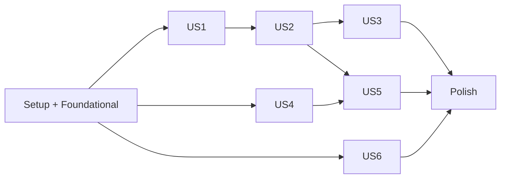

# Tasks: Google Sign-In and Connections

**Input**: Design documents from `specs/001-google-sign-in/`

**Prerequisites**: [plan.md](plan.md), [spec.md](spec.md), [research.md](research.md), [data-model.md](data-model.md), [contracts/http.md](contracts/http.md), [quickstart.md](quickstart.md)

**Tests**: Required. SC-001, SC-005 and SC-008 call for automated coverage, and AGENTS.md requires positive, negative, error and edge-case tests for every new module. Unit tests go in `tests/unit/` mirroring `src/`; E2E tests go in `tests/e2e/`. Mock only at process boundaries (KMS, Google HTTP, GCS, Secret Manager); the database runs as PGlite with the real migrations, never mocked.

**Organization**: Tasks are grouped by user story. US5 is P2; all others are P1.

## Format: `[ID] [P?] [Story] Description`

- **[P]**: Can run in parallel (different files, no dependency on an unfinished task)
- **[Story]**: The user story the task serves (US1–US6)

---

## Phase 1: Setup

**Purpose**: Config changes. T001, T003 and T004 are approved; 👤 items are yours (T002 from a diff I draft; T005 through the Neon MCP if you OK it).

- [x] T001 Add exact pins to package.json and pnpm-lock.yaml: `pnpm add @google-cloud/kms@6.2.1 drizzle-orm@0.45.3 pg@8.23.1` and `pnpm add -D drizzle-kit@0.31.11 @types/pg@8.23.1 @electric-sql/pglite@0.5.8` (research R7, R12)
- [x] T002 [P] 👤 You apply: add env `SIGNUP_MODE` (`invite|open`), `KMS_KEY`, `DATABASE_URL` and `DATABASE_URL_UNPOOLED`, and remove `ALLOWLIST_EMAILS` and `DEMO_EMAILS`, in .env.example, service.yaml and playwright.config.ts
- [x] T003 [P] In vite.config.ts under `E2E_FAKES=1`: alias `@google-cloud/kms` to `tests/e2e/fakes/kms.ts` and `$lib/server/core/db` to `tests/e2e/fakes/db.ts`; drop the Firestore alias; keep Storage and Secret Manager. In vitest.config.ts, alias `$lib/server/core/db` to `tests/helpers/db.ts` so unit tests hit PGlite without mocking an internal module
- [x] T004 [P] Create drizzle.config.ts: `dialect: 'postgresql'`, schema `src/lib/server/core/schema.ts`, out `drizzle/`, credentials from `DATABASE_URL_UNPOOLED` (direct connection; migrations fail through the pooler)
- [ ] T005 👤 Neon project `soundboard` (`withered-river-18454408`, `aws-us-east-2`) exists. Put its pooled connection string in Secret Manager as `DATABASE_URL` and the direct one as `DATABASE_URL_UNPOOLED`, then time a claim `UPDATE … RETURNING` from local and from Cloud Run, cold and warm; record the numbers under R12 in specs/001-google-sign-in/research.md

---

## Phase 2: Foundational (Blocking Prerequisites)

**Purpose**: The new user, session, connection and job shapes, plus removal of the visitor/demo/sample paths that every story's code currently branches on (FR-020).

**⚠️ CRITICAL**: No user story work starts until this phase passes `make ai-checks`.

### Shapes and storage

- [x] T006 Create src/lib/server/core/schema.ts with every table, column, constraint and index in [data-model.md](data-model.md) (e.g. `token_ciphertext` check "`status = 'connected' or token_ciphertext is null`", `bound_sub` unique, job-list index `(owner_uid, created_at desc) WHERE parent_id IS NULL`); run `pnpm drizzle-kit generate` and commit the SQL in drizzle/
- [x] T007 Create src/lib/server/core/db.ts: `db()` returns Drizzle over a `pg` Pool built from `DATABASE_URL`; remove the Firestore client from src/lib/server/core/clients.ts and keep `resetClients()` dropping the pool; tests in tests/unit/lib/server/core/db.test.ts
- [x] T008 Create tests/helpers/db.ts (after T006: a fresh PGlite per test file with drizzle/ migrations applied via the PGlite migrator, plus `seed()`), and tests/e2e/fakes/db.ts exporting the same `db()` over an in-memory PGlite seeded from tests/e2e/fakes/fixtures.ts; delete tests/helpers/fake-firestore.ts and tests/e2e/fakes/firestore.ts
- [x] T009 Replace job ownership fields in src/lib/types.ts: add `ownerUid: string`, `artistId: string | null`, `destination: {channelId, channelTitle} | null`, top-level `parentId: string | null` ("`null` on videos, the parent's ID on Shorts"), `uploadStartedAt: number | null`, `finalChunkAt: number | null`; remove `owner`, `channel`, `sampleId`, `liveVideoId`, `ipHash`, `JobOwner` and `Channel`; keep them out of `JobView`
- [x] T010 [P] Set `locals.user: {uid, email, artistId} | null` in src/app.d.ts
- [x] T011 [P] Remove `allowlist()` and `demoEmails()` and add `signupMode(): 'invite' | 'open'` (default `invite`) and `kmsKey()` in src/lib/server/core/env.ts, with tests in tests/unit/lib/server/core/env.test.ts
- [x] T012 [P] Create src/lib/server/core/kms.ts with `encrypt(plain): Promise<string>` (base64 ciphertext) and `decrypt(cipher): Promise<string>` against `KMS_KEY`, never logging or setting either value on a span; tests in tests/unit/lib/server/core/kms.test.ts mocking the KMS client
- [x] T013 [P] Create tests/e2e/fakes/kms.ts: a reversible in-memory encrypt/decrypt with the `KeyManagementServiceClient` surface kms.ts uses
- [x] T014 Create src/lib/server/auth/users.ts:
  - `getUser(uid)`
  - `upsertUser(uid, {email, name})`, which updates email/name only and **never writes `accessGeneration`**
  - `redeemInvite(sub, email)` in one database transaction: look up the `users` row by `uid` first and check the invite named by its `invite_email`; only a first sign-in looks the invite up by the token's normalized email ("Lowercased, trimmed"). Bind with the data model's `UPDATE invites SET bound_sub = $sub WHERE … (bound_sub IS NULL OR bound_sub = $sub)` ("Only this `sub` may redeem it afterwards"); zero rows = denied, copy `artistId`, create the user with `accessGeneration: 1`. Return `denied` for a missing, inactive or foreign-bound invite and write nothing
  - `signupMode() === 'open'` skips the invite and creates the user with `inviteEmail: null`, `artistId: null`
  - Tests in tests/unit/lib/server/auth/users.test.ts: first redemption, returning user with changed email, foreign `sub` on a bound invite, inactive invite, open mode, upsert leaving `accessGeneration` untouched
- [x] T015 Rewrite sessions in src/lib/server/auth/auth.ts:
  - Session payload `{uid, sid, gen, exp}`; `sid` random per sign-in; `exp` = sign-in + `SESSION_TTL_SEC`, fixed
  - OAuth state `{nonce, purpose: 'sign-in' | 'connect', uid: string | null, sid: string | null, exp}` with `exp` 10 minutes out, cookie path `/auth`
  - Remove `isAllowlisted`, `isDemo`, `Session.allowlisted/demo` and the `channel: 'nathan' | 'sandbox'` state field
  - `readSession` rejects a bad signature, `exp <= now`, or a payload without `uid`
  - Tests in tests/unit/lib/server/auth/auth.test.ts: round trip, tamper, expiry, missing `uid`, state expiry
- [x] T016 Create src/lib/server/platforms/youtube/connection.ts replacing tokens.ts:
  - `getConnection(uid)`, `putConnection(uid, row)` (one upsert of status, channel and `tokenCiphertext`), `deleteConnection(uid)`
  - `markRevoked(uid)` sets `status: 'revoked'` and clears `tokenCiphertext` in the same write
  - `accessTokenFor(uid, channelId)`: decrypt, refresh, return null unless `status === 'connected'` and `channelId` matches; `invalid_grant` → `markRevoked`
  - Statuses exactly `'connected' | 'missing_scopes' | 'no_channel' | 'revoked'`; "`tokenCiphertext`… Null unless `connected`"
  - Tests in tests/unit/lib/server/platforms/youtube/connection.test.ts; delete src/lib/server/platforms/youtube/tokens.ts and its test
- [x] T017 Export the connection functions from src/lib/server/platforms/youtube/index.ts and drop the `tokens` exports; keep `YouTubeError` unexported

### Storage rewrite

- [x] T018 Move src/lib/server/jobs/jobs.ts to Drizzle: job rows with `data` jsonb, `job_picks`/`job_chunks` child tables, the claim as one `UPDATE jobs SET claim_token = $2, claim_until = now() + interval '3 minutes' WHERE id = $1 AND (claim_until IS NULL OR claim_until < now()) RETURNING *` with a fresh random token, and today's transactions as `db().transaction()`. Preserve the claim-token check atomically for result/child-table writes and release; release nulls `claim_token` and `claim_until` together; normal state changes also require the claimed state. Port tests/unit/lib/server/jobs/jobs.test.ts to tests/helpers/db.ts, including: A's claim expires, B acquires a fresh token, A completes late and neither writes results nor clears B's claim, then B completes successfully. Drop `owner`/`channel`/sandbox handling from jobs.ts in the same pass
- [x] T019 Move src/lib/server/jobs/actions.ts to Drizzle in one pass, stripping legacy code as it moves, and delete quota.ts:
  - Delete src/lib/server/jobs/quota.ts and tests/unit/lib/server/jobs/quota.test.ts; YouTube's own limits replace the app count (research R8)
  - actions.ts: remove `allowlistedFor`, the upload-slot reservation and the visitor `ipHash` charge in `makeShort`; `makeShort` copies `ownerUid`, `artistId` and a null destination from the parent and sets top-level `parentId`
  - Port tests/unit/lib/server/jobs/actions.test.ts
- [x] T020 [P] Move src/lib/server/artist/memory.ts and src/lib/server/artist/brand.ts to the artist tables (`artist_facts`, `artist_feedback`, `artist_publishes`, `artist_brand`); port their tests
- [x] T021 Remove `@google-cloud/firestore` from package.json and pnpm-lock.yaml once `grep -rn "@google-cloud/firestore" src tests scripts` is empty

### Remove legacy paths (FR-020)

- [x] T022 Delete src/lib/server/jobs/samples.ts, tests/unit/lib/server/jobs/samples.test.ts, src/lib/components/Diff.svelte, tests/unit/lib/components/Diff.test.ts and scripts/add-sample.sh
- [x] T023 Make create take an owner in src/lib/server/jobs/create.ts: `create(input, user)` sets `ownerUid: user.uid`, `artistId: user.artistId`, `destination: null`, `parentId: null`, null upload markers; remove `{sampleId}`, `ownerFor`, `Who`, `UPLOAD_CHANNEL`, the per-owner minute caps (15 minutes for everyone) and visitor-run charging. Update tests/unit/lib/server/jobs/create.test.ts
- [x] T024 Remove `owner`/`channel`/sandbox handling from src/lib/server/pipeline/pipeline.ts, src/lib/server/pipeline/short.ts, src/lib/api.ts, src/lib/status.ts and their tests; remove the unreachable `PAYLOAD` state, the job's `payload` field and src/lib/components/Payload.svelte with its test, including its branches in src/routes/jobs/[id]/+page.svelte and src/lib/components/Short.svelte
- [x] T025 Replace allowlisted/demo/visitor fixtures with seeded `users`, `invites` and `connections` for two users (A linked to `flr`, B unlinked) in tests/e2e/fakes/fixtures.ts and tests/helpers/pipeline.ts, inserted through `seed()`

**Checkpoint**: `make ai-checks` passes with the new shapes and no visitor/demo/sample code.

---

## Phase 3: User Story 1 - Signed out, the app shows only sign-in (P1) 🎯 MVP

**Goal**: No session → only the sign-in view; every API 401s; nothing written.

**Independent Test**: Fresh browser sweep: pages land on sign-in, APIs return 401 with no writes, `/` sets zero cookies.

### Tests

- [x] T026 [P] [US1] Route sweep in tests/unit/hooks.server.test.ts: enumerate every `src/routes/**/+page*.ts` and `+server.ts` via `import.meta.glob`; signed-out pages → 303 `/`, `/api/*` → 401 `{"message":"Sign in first."}`; only `/`, `/auth/login`, `/auth/callback`, `/auth/logout`, `/health` exempt, each asserted individually (SC-001); every response carries `content-security-policy: frame-ancestors 'self'` (FR-019)
- [x] T027 [P] [US1] E2E in tests/e2e/auth.spec.ts: signed-out `/` sets zero cookies (SC-002), `/jobs/x`, `/brand`, `/connections` redirect to `/`, `POST /api/jobs` returns 401; desktop Chrome and Pixel 7

### Implementation

- [x] T028 [US1] Gate in src/hooks.server.ts: resolve the session cookie → `getUser(uid)` → require `gen === accessGeneration`, set `locals.user` or null; apply the contract's gate table with no wildcard API exemption (FR-002); set `content-security-policy: frame-ancestors 'self'` (drop dev.to, FR-019)
- [x] T029 [P] [US1] Create src/lib/components/SignIn.svelte: a single "Sign in with Google" link to `/auth/login`, plain notices for `?signin=denied` ("not invited") and `?signin=expired` ("sign-in expired, try again"); tests in tests/unit/lib/components/SignIn.test.ts
- [x] T030 [US1] Render SignIn when `locals.user` is null in src/routes/+page.server.ts and src/routes/+page.svelte, with no app data and no `Set-Cookie`; remove the sample list and signed-out upload. Update tests/unit/routes/page.server.test.ts and page.test.ts
- [x] T031 [US1] Make a 401 from any step final in src/lib/driver.ts: stop and navigate to `/` (today it retries a 401 forever). Update tests/unit/lib/driver.test.ts

**Checkpoint**: US1 independently testable.

---

## Phase 4: User Story 2 - One Google sign-in grants identity and YouTube (P1)

**Goal**: One consent screen; the user lands home with their channel connected and stays signed in 30 days.

**Independent Test**: Invited sign-in → home shows own channel, no second connect step; reopening the browser stays signed in.

### Tests

- [ ] T032 [P] [US2] Callback tests in tests/unit/routes/auth/callback/server.test.ts covering every row of the contract's callback table and evaluation steps 1–6: read-only, upload-only and neither-scope grants; no channel; refresh token present; no refresh token with a `connected` matching row kept; no refresh token and no usable grant → 303 `/auth/login?connect=youtube`; a `revoked` doc never revived by sign-in; mismatched/expired/replayed state
- [x] T033 [P] [US2] Login tests in tests/unit/routes/auth/login/server.test.ts: no query → 4 scopes, `access_type=offline`, `include_granted_scopes=true`, `prompt=select_account`; `?connect=youtube` with session → `prompt=select_account consent` and `login_hint`; without session → 401; any other `connect` → 400
- [x] T034 [P] [US2] Logout tests in tests/unit/routes/auth/logout/server.test.ts: deletes `sb_session` and `sb_oauth`

### Implementation

- [x] T035 [US2] Rewrite src/routes/auth/login/+server.ts per the contract's login table; remove `nathan`/`sandbox` connect values (FR-020)
- [ ] T036 [US2] Rewrite src/routes/auth/callback/+server.ts: verify state (delete `sb_oauth` on first read), exchange code, verify the ID token and email; sign-in → `redeemInvite` → `upsertUser` → set `sb_session` with a new `sid` → evaluate YouTube; evaluation per contract steps 1–6, splitting `tokens.scope` on spaces, `channels.list?mine=true` through the new access token, encrypt and write in one `putConnection`
- [x] T037 [US2] Return `{email, sub, idToken claims, scopes, refreshToken, accessToken}` from `exchangeCode` in src/lib/server/auth/auth.ts and add `channelsMine(accessToken)` in src/lib/server/platforms/youtube/youtube.ts returning `{id, title} | null`; tests alongside
- [x] T038 [US2] Delete `sb_oauth` as well as `sb_session` in src/routes/auth/logout/+server.ts
- [ ] T039 [US2] Show the signed-in user's own channel in the header: `channelStats(channelId)` with a cache keyed by channel ID in src/lib/server/platforms/youtube/youtube.ts (FR-030 fix for today's single cache), read from `getConnection(locals.user.uid)` in src/routes/+layout.server.ts; header links Connections and, only when `artistId === 'flr'`, Brand guide in src/routes/+layout.svelte. Update tests/unit/routes/layout.server.test.ts and layout.test.ts

**Checkpoint**: US1 + US2 testable.

---

## Phase 5: User Story 3 - Uninvited accounts are turned away (P1)

**Goal**: Only invited accounts get a session; revocation signs users out on the next request.

**Independent Test**: Uninvited sign-in shows "not invited", leaves no cookie, user or token, and every API 401s.

### Tests

- [ ] T040 [P] [US3] Callback denial tests in tests/unit/routes/auth/callback/server.test.ts: uninvited → 303 `/?signin=denied`, no cookie, no `users` row, no connection; invite bound to another `sub` denied; changed email on a bound user keeps jobs and `artistId`
- [ ] T041 [P] [US3] Generation tests in tests/unit/hooks.server.test.ts: revoke bumps `accessGeneration` → next request signed out; reactivation does not revive the old cookie
- [ ] T042 [P] [US3] Script tests in tests/unit/scripts/invite.test.ts for add, revoke (one transaction: `active: false` + increment bound user's `accessGeneration`), reactivate and list

### Implementation

- [ ] T043 [US3] Create scripts/invite.ts (`add <email> [--artist flr]`, `revoke <email>`, `list`) with a standalone `pg` client on `DATABASE_URL` and no `$lib` imports, runnable as `node scripts/invite.ts` under Node 24 type stripping
- [ ] T044 [US3] Wire the denied path in src/routes/auth/callback/+server.ts to write nothing before `redeemInvite` succeeds (FR-005)

**Checkpoint**: US1–US3 testable.

---

## Phase 6: User Story 4 - Users only see and act on their own work (P1)

**Goal**: Per-user jobs, uploads to the owner's pinned channel, no shared caches, no FLR data for unlinked users.

**Independent Test**: Two users in two browsers each create and approve a job; uploads land on each owner's channel; neither opens the other's job; signing one out leaves the other.

### Tests

- [ ] T045 [P] [US4] Isolation tests in tests/unit/lib/server/jobs/view.test.ts and every tests/unit/routes/api/jobs/[id]/**/server.test.ts: a foreign `ownerUid` gets 404 on every job page and API (FR-012)
- [ ] T046 [P] [US4] One-process interleave test A → B → A in tests/unit/routes/isolation.test.ts covering header stats, Connections, job lists, media URLs and Short mutations (SC-005)
- [ ] T047 [P] [US4] Upload-gating tests in tests/unit/lib/server/pipeline/pipeline.test.ts: initiation, chunks and read-back use only `accessTokenFor(job.ownerUid, job.destination.channelId)`; a missing or revoked grant → wait "reconnect YouTube"; `uploadStartedAt` survives session reset, retry and reconnect
- [ ] T048 [P] [US4] Unlinked-pick tests in tests/unit/lib/server/ai/smart-pick.test.ts and tests/unit/lib/server/artist/memory.test.ts: `artistId` null, or owner's current `artistId` ≠ `flr` → no read or write of artist rows with `artist_id = 'flr'`, no `recentVideos`, no `PUBLIC_FACTS`, no `artist` field, no forced `ARTIST_NAME` tag; feedback stays on the job
- [ ] T049 [P] [US4] E2E in tests/e2e/isolation.spec.ts: two seeded users, each sees only their own job and gets 404 on the other's; signing out A leaves B signed in; one user in two browser contexts, signing out one leaves the other signed in (FR-011)

### Implementation

- [ ] T050 [US4] `authorizedJob(id, uid)` in src/lib/server/jobs/view.ts: 404 unless `job.ownerUid === uid`; issue signed media URLs only after that check (FR-030). Update all callers in src/routes/api/jobs/** and src/routes/jobs/[id]/+page.server.ts to pass `locals.user.uid`
- [ ] T051 [US4] Pass `locals.user` to `create` in src/routes/api/jobs/+server.ts; reject `{sampleId}`
- [ ] T052 [US4] Approve pins destination in src/lib/server/jobs/actions.ts: 409 `"Reconnect YouTube to approve."` unless the owner's connection is `connected`; record `destination` in the same transaction. Show the destination channel ID and name on approval in src/lib/components/Destinations.svelte
- [ ] T053 [US4] Gate FLR identity by artist in src/lib/server/ai/smart-pick.ts (`smart-pick.ts:143-174`), src/lib/server/jobs/actions.ts (approve-time tag check, `actions.ts:46`) and src/lib/server/artist/memory.ts (`memory.ts:31`): FLR data only when the job's and the owner's current `artistId` both equal `flr`; `ARTIST_VOICE` stays shared
- [ ] T054 [US4] Pass `FLR_CHANNEL_ID` explicitly to `recentVideos` in src/lib/server/artist/brand.ts; replace `requireAllowlisted` with a `user.artistId === 'flr'` check (404 otherwise) in src/lib/server/artist/brand.ts, src/routes/brand/+page.server.ts and src/routes/api/brand/{approve,discard,propose}/+server.ts; remove the Brand guide connect links in src/routes/brand/+page.svelte
- [ ] T055 [US4] Upload gating in src/lib/server/pipeline/pipeline.ts: every upload step first checks the pinned channel's connection is `connected` (session PUTs carry no auth header); persist `uploadStartedAt` before the initiation request, never cleared by reset/retry/reconnect; use `accessTokenFor(job.ownerUid, job.destination.channelId)` for initiation and read-back

**Checkpoint**: US1–US4 testable.

---

## Phase 7: User Story 6 - Return to interrupted work (P1)

**Goal**: Home lists the user's own root jobs, newest first, with a continue link.

**Independent Test**: Expire a session mid-run, sign in, find the job on home and continue it.

### Tests

- [ ] T056 [P] [US6] `listJobs` tests in tests/unit/lib/server/jobs/jobs.test.ts: own root jobs only, newest 20, Shorts excluded via `parentId == null`
- [ ] T057 [P] [US6] E2E in tests/e2e/home.spec.ts: each user's home lists only their jobs; a job link opens the job page

### Implementation

- [ ] T058 [US6] Add `listJobs(uid)` in src/lib/server/jobs/jobs.ts: `ownerUid ==`, `parentId == null`, `createdAt desc`, limit 20, returning `{id, songTitle, state, createdAt}[]`
- [ ] T059 [P] [US6] Create src/lib/components/JobList.svelte (song title, plain state label, continue link); tests in tests/unit/lib/components/JobList.test.ts
- [ ] T060 [US6] Load `jobs` in src/routes/+page.server.ts and render JobList under the upload form in src/routes/+page.svelte
- [ ] T061 [US6] On the job page, when source or rendered media is gone (7-day GCS lifecycle), keep saved metadata visible and show that media-dependent work needs a new upload, in src/routes/jobs/[id]/+page.svelte and src/lib/server/jobs/view.ts (FR-029)

**Checkpoint**: All P1 stories testable.

---

## Phase 8: User Story 5 - The Connections page manages platform links (P2)

**Goal**: View, reconnect and disconnect YouTube; paused jobs resume on the same channel without a duplicate upload.

**Independent Test**: Revoke app access at Google, open Connections, see "reconnect", reconnect, and uploads work again.

### Tests

- [ ] T062 [P] [US5] Connections page tests in tests/unit/routes/connections/page.server.test.ts and page.test.ts: every status renders its plain fix line
- [ ] T063 [P] [US5] Disconnect tests in tests/unit/routes/api/connections/youtube/disconnect/server.test.ts: revokes at Google, deletes the row on revoke failure too, 204, 401 signed out
- [ ] T064 [P] [US5] Connect-callback tests in tests/unit/routes/auth/callback/server.test.ts: `uid` or `sid` mismatch, signed out, or a stale callback after sign-out and back in → 303 `/connections?connect=mismatch`, no change (FR-026); a grant whose ID token `sub` ≠ the session `uid` → 303 `/connections?connect=wrong-account`, no change (FR-023); a failed reconnect keeps the stored connection
- [ ] T065 [P] [US5] Recovery tests in tests/unit/lib/server/pipeline/pipeline.test.ts:
  - same-channel reconnect resumes before initiation, mid-upload and before verification with no second upload (SC-006)
  - status check complete → keep video ID and verify; incomplete → resume from offset
  - 404 with `finalChunkAt` null → fresh session, same destination
  - 404 with `finalChunkAt` set → `upload` cleared, wait "upload outcome unknown"; later steps match `PUBLISHING && finalChunkAt != null && upload == null && videoId == null` and make no YouTube call
  - YouTube `quotaExceeded` and `uploadLimitExceeded` on initiation or a chunk → wait "Daily upload limit reached. Try tomorrow.", job stays `PUBLISHING`, no failure counted; the next step after reset continues
  - Retry after a lost final chunk never restarts
  - 401 counts as lost access, not unknown outcome
- [ ] T066 [P] [US5] confirm-upload tests in tests/unit/routes/api/jobs/[id]/confirm-upload/server.test.ts: `watch?v=`, `youtu.be/`, `/shorts/`, Studio `/video/` accepted; other input 400; foreign job 404; job not matching the outcome-unknown check (`PUBLISHING`, `finalChunkAt` set, `upload` and `videoId` null) 409; missing or wrong-channel video 422 with no job change; success → `CLAIMED_COMPLETE` with no new upload
- [ ] T067 [P] [US5] Discard tests in tests/unit/lib/server/jobs/actions.test.ts and tests/unit/lib/server/jobs/jobs.test.ts: discard allowed in `PUBLISHING` and `CLAIMED_COMPLETE`; a step result after discard still saves `videoId` only with its matching claim token, without restoring the old state or replacing unrelated data; a superseded token saves nothing and never clears a newer claim (`releaseJob`, `jobs.ts:151-153`)
- [ ] T068 [P] [US5] E2E in tests/e2e/connections.spec.ts: Connections renders every status; Discard works on a paused job

### Implementation

- [ ] T069 [US5] Create src/routes/connections/+page.server.ts and +page.svelte: one YouTube row with status, channel title, and Reconnect (`/auth/login?connect=youtube`) or Disconnect
- [ ] T070 [US5] Add `revokeGrant(uid)` in src/lib/server/platforms/youtube/connection.ts (POST to `https://oauth2.googleapis.com/revoke`, log a failure and delete the row anyway) and export it from index.ts, with tests; create src/routes/api/connections/youtube/disconnect/+server.ts calling it and returning 204
- [ ] T071 [US5] Connect branch of src/routes/auth/callback/+server.ts: require session `uid` and `sid` to equal the state's and the ID token `sub` to equal the session `uid`; validate the new grant fully before one overwriting write (FR-027)
- [ ] T072 [US5] Final-chunk marker in src/lib/server/pipeline/pipeline.ts: persist top-level `finalChunkAt` before sending the chunk that reaches the file size; on session 404 branch per [data-model.md](data-model.md#publishing-and-verification-with-a-pinned-destination), clearing `upload` when `finalChunkAt` is set; export one `outcomeUnknown(job)` predicate for steps and T075; map YouTube `quotaExceeded` and `uploadLimitExceeded` to wait "Daily upload limit reached. Try tomorrow." (extend `uploadFailure()`'s existing `'quota-spent'` outcome in src/lib/server/platforms/youtube/youtube.ts to cover `uploadLimitExceeded`)
- [ ] T073 [US5] Keep `videoId` and upload progress in `releaseJob` when the job moved state in src/lib/server/jobs/jobs.ts only if the claim token still matches, preserving the new state and unrelated data; stale tokens never write or release a newer claim. Allow discard in `PUBLISHING` and `CLAIMED_COMPLETE` in src/lib/server/jobs/actions.ts and src/routes/api/jobs/[id]/discard/+server.ts
- [ ] T074 [US5] Add `videoChannel(accessToken, id): Promise<string | null>` (`videos.list?part=snippet&id=`) in src/lib/server/platforms/youtube/youtube.ts and export it from index.ts
- [ ] T075 [US5] Create src/routes/api/jobs/[id]/confirm-upload/+server.ts per the contract: require `outcomeUnknown(job)`, parse `{url}`, read through the pinned grant, atomically re-check job and destination, save the ID, move to `CLAIMED_COMPLETE`
- [ ] T076 [US5] Outcome-unknown UI in src/routes/jobs/[id]/+page.svelte: YouTube Studio uploads link for the pinned channel, a paste-URL field posting to confirm-upload, and Discard; plain labels only

**Checkpoint**: All stories testable.

---

## Phase 9: Polish & Cross-Cutting

- [ ] T077 👤 You apply deploy.sh: create the `soundboard` key ring and `refresh-tokens` key in us-central1, grant the runtime service account `roles/cloudkms.cryptoKeyEncrypterDecrypter` on that key, add the `DATABASE_URL` and `DATABASE_URL_UNPOOLED` secrets, run `pnpm drizzle-kit migrate` over the unpooled URL before traffic moves, drop the Firestore setup and its IAM role, set `SIGNUP_MODE` and `KMS_KEY`, drop `ALLOWLIST_EMAILS`/`DEMO_EMAILS` and the `yt-refresh-*` secret creation. After the first deploy, delete the Firestore database and the existing `yt-refresh-*` secrets by hand. I draft the exact diff for you
- [ ] T078 [P] Update AGENTS.md "Data and access" for users, invites, connections and `ownerUid`, removing allowlist/demo/visitor rules (FR-021); replace its Firestore lines (step claim, mock boundaries, E2E aliases) with Postgres, PGlite and the db alias. Update docs/prd.md the same way: replace its Firestore security-rules line, the State and Region lines, the step-claim line and the `### Firestore` section with Neon, Drizzle and the claim token (FR-021)
- [ ] T079 [P] Update README.md setup: Neon `DATABASE_URL`, `drizzle-kit migrate`, invites, `SIGNUP_MODE`, KMS key, Connections; remove sample and sandbox guidance
- [ ] T080 Legacy sweep for SC-007: `grep -rn "visitor\|demo\|sample\|sandbox\|allowlist\|dev\.to\|DEMO_EMAILS\|ALLOWLIST" src tests scripts deploy.sh service.yaml README.md AGENTS.md` returns only removal text
- [ ] T081 Run `make ai-checks` (coverage floors 85/85/85/80) and `pnpm test:e2e`; run the Sonar and Semgrep scans; fix every warning
- [ ] T082 Run the deployed manual checks in [quickstart.md](quickstart.md#manual-deployed)

---

## Dependencies & Execution Order

### Phase Dependencies

- **Setup (Phase 1)**: T002 must land before Phase 2's env work.
- **Foundational (Phase 2)**: blocks every story. T006–T008 first (schema, client, PGlite), then T009; T014–T020 depend on them and on T011, T012.
- **US1 (Phase 3)**: after Phase 2.
- **US2 (Phase 4)**: after US1 (callback sets the session the gate reads).
- **US3 (Phase 5)**: after US2 (shares the callback).
- **US4 (Phase 6)**: after Phase 2; independent of US2/US3 in tests via seeded sessions.
- **US6 (Phase 7)**: after Phase 2; T058 needs T008 and T018.
- **US5 (Phase 8)**: after US2 (connect flow) and US4 (destination lock, T055).
- **Polish (Phase 9)**: last.

### Story Completion Order



### Within Each Story

- Tests first and failing, then implementation.
- Shared files: callback (T036, T044, T071) and pipeline.ts (T055, T072) are edited in story order, never in parallel.

## Parallel Examples

```text
# Phase 2 after T006–T009:
T010 app.d.ts · T011 env.ts · T012 kms.ts · T013 fake kms

# US4 tests together:
T045 view/route 404s · T046 interleave · T047 upload gating · T048 unlinked picks · T049 E2E

# US5 tests together:
T062–T068
```

## Implementation Strategy

### MVP

1. Phases 1–2.
2. US1 (gate) → validate the route sweep.
3. US2 + US3 → invited sign-in works end to end.
4. US4 + US6 → safe for a second user.
5. **Stop and validate**; this is the minimum before inviting Ashley's account.

### Then

- US5 (Connections, recovery, confirm-upload), then polish.
- Commit after each task or logical group; never push without being asked.

---

## Phase 10: Convergence

- [x] T083 Move per-job feedback from `jobs/{id}/feedback` to the `job_feedback` child table in src/lib/server/artist/memory.ts, so unlinked users' feedback stays on the job, with tests per FR-018 (partial)
- [ ] T084 Port tests/e2e/header.spec.ts, tests/e2e/brand.spec.ts and tests/e2e/short.spec.ts from allowlisted/demo cookies to the seeded users and `{uid, sid, gen, exp}` sessions per FR-020 (partial)
- [ ] T085 Add an E2E in tests/e2e/auth.spec.ts: a session that stops validating mid-run makes the job page navigate to `/` per quickstart E2E and Edge Cases (missing)
- [x] T086 Remove the sample-only `excludeId` parameter from src/lib/server/pipeline/hashtags.ts and its callers and tests per FR-020 (partial)
