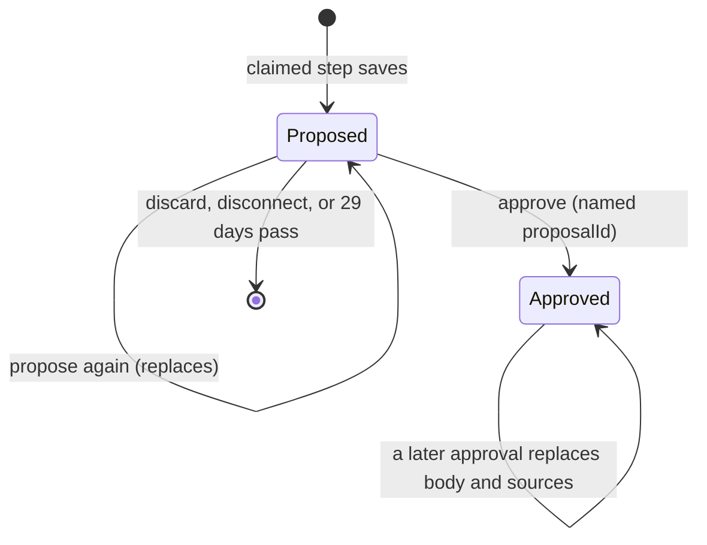

# Data model: Per-artist voice and brand guide

Source of truth after implementation: `src/lib/server/core/schema.ts` and the generated migration in `drizzle/`. Rationale is in [research.md](research.md).

## `artist_guides` (new table)

| Column        | Type                          | Rules                                                                                      |
| ------------- | ----------------------------- | ------------------------------------------------------------------------------------------ |
| `id`          | `integer` PK, identity always | The `proposalId` approve and discard name (R9).                                            |
| `artist_id`   | `text` NN                     | `REFERENCES artists(id)`.                                                                  |
| `kind`        | `text` NN                     | `CHECK kind in ('voice', 'brand')`.                                                        |
| `status`      | `text` NN                     | `CHECK status in ('proposed', 'approved')`.                                                |
| `body`        | `jsonb` NN                    | Voice: `{ rules: string[] }`. Brand: `{ statement, keep[], fix[], drop[] }`.               |
| `sources`     | `jsonb` NN                    | Proposed: `ProposalSources`. Approved: `SourceSummary` (below).                            |
| `proposed_at` | `timestamptz` NN              | The claim's `claimed_at`, taken before the first input read (R4). Approved rows keep it.   |
| `approved_at` | `timestamptz` null            | `CHECK (status = 'approved') = (approved_at is not null)`.                                 |
| `grant_at`    | `timestamptz` null            | The connection generation the claim saw (T037). Null when approved or claimed unconnected. |

- **Unique** `artist_guides_slot` on `(artist_id, kind, status)`: at most one proposal and one approved version per artist and kind (FR-001).
- **Check** `artist_guides_sources_check`: exact keys and types, null-safe (R4). Every comparison uses `IS NOT DISTINCT FROM`, so a missing key fails instead of passing as SQL `NULL`:
  - **proposed:** `jsonb_typeof(sources)` is `'object'`; `sources - array['uploads','drafts','edits','approvals','thin'] = '{}'`; `uploads` and `drafts` are `'array'`; `edits` and `approvals` are `'number'`; `thin` is `'boolean'`.
  - **approved:** `jsonb_typeof(sources)` is `'object'`; `sources - array['uploads','drafts','edits','approvals','carriedOver'] = '{}'`; `uploads`, `drafts`, `edits`, `approvals` are `'number'`; `carriedOver` is `'boolean'`.
  - An approved row can't hold an upload list, a video ID, a title or an extra key (FR-004).
- **Index** `artist_guides_expiry_idx` on `(proposed_at) where status = 'proposed'`, for the daily delete.
- **RLS** (`ENABLE` + `FORCE`):
  - _Own_ means `exists (select 1 from public.users u where u.uid = <principal> and u.active and u.artist_id = artist_guides.artist_id)`. The column is table-qualified (`${t.artistId}` in Drizzle, as `schema.ts:198` does); unqualified, `artist_id` binds to `users` and every row matches (Codex #1).
  - _Fresh_ means `(status = 'approved' or proposed_at > now() - interval '29 days')`.
  - `guides_read` `FOR SELECT TO soundboard_app USING` own and fresh.
  - `guides_insert` `FOR INSERT TO soundboard_app WITH CHECK` own and `status = 'approved'` and `proposed_at <= now() and proposed_at > now() - interval '29 days'`. The app inserts only approved rows; proposals go through the function below.
  - `guides_update` `FOR UPDATE TO soundboard_app USING` own and fresh, `WITH CHECK` the same as `guides_insert`. `USING` lets approve lock a fresh proposal (`FOR UPDATE`); `WITH CHECK` lets only approved rows be written.
  - `guides_delete` `FOR DELETE TO soundboard_app USING` own and `status = 'proposed'` (and fresh, through the read policy). Nothing in the app deletes an approved row.
  - `guides_cleanup_read` (`FOR SELECT`) and `guides_cleanup_delete` (`FOR DELETE`) `TO soundboard_cleanup`, `USING status = 'proposed' and proposed_at <= now() - interval '29 days'`.
- **Grants:**
  - `soundboard_app`: `SELECT`, `INSERT`, `UPDATE (body, sources, proposed_at, approved_at)`, `DELETE`, and `EXECUTE` on `soundboard_save_proposal`. `INSERT` covers every column because Drizzle names them all; the insert policy allows only approved rows, and the approved check keeps their `grant_at` null.
  - `soundboard_cleanup`: `SELECT (id, status, proposed_at)`, `DELETE`.

## `guide_claims` (new table)

One row per artist and kind, made on first propose. Holds no YouTube data.

| Column        | Type               | Rules                                                                               |
| ------------- | ------------------ | ----------------------------------------------------------------------------------- |
| `artist_id`   | `text` NN          | `REFERENCES artists(id)`. PK with `kind`.                                           |
| `kind`        | `text` NN          | `CHECK kind in ('voice', 'brand')`.                                                 |
| `claim_token` | `text` null        | The running step's token. Null when free.                                           |
| `claimed_at`  | `timestamptz` null | Database `now()` at claim; becomes the proposal's `proposed_at`.                    |
| `claim_until` | `timestamptz` null | `claimed_at + 3 minutes`. A past value frees the slot.                              |
| `limit_until` | `timestamptz` null | The model's per-day quota reset (`ModelQuotaSpent.until`). Holds claims until then. |
| `grant_at`    | `timestamptz` null | The `connected` row's `updated_at` at claim time (T037); database-set.              |

- **RLS** (`ENABLE` + `FORCE`): `claims_own` `FOR ALL TO soundboard_app` `USING` and `WITH CHECK` own, with `guide_claims.artist_id` qualified as above.
- **Grants:** `soundboard_app`: `SELECT`, `UPDATE (claim_token, claim_until, limit_until)`. No `INSERT`, no `DELETE`, no write to `claimed_at` or `grant_at` (T036).
- **Claim** (R8, T036): `public.soundboard_claim_proposal(p_kind, p_token)` (definer, as below) inserts the row once, then `UPDATE … SET claim_token = p_token, claimed_at = now(), claim_until = now() + interval '3 minutes', grant_at = <the caller's connected updated_at> WHERE` free and not quota-held, and returns the row either way.
- **Release:** `UPDATE guide_claims SET claim_token = null, claim_until = null [, limit_until = $until] WHERE artist_id = $a AND kind = $k AND claim_token = $token`. A wrong token changes 0 rows.

### Function `soundboard_save_proposal(p_kind text, p_body jsonb, p_sources jsonb, p_claim_token text) RETURNS SETOF public.artist_guides`

- `LANGUAGE plpgsql SECURITY DEFINER`, `SET search_path = pg_catalog, public, pg_temp`, every relation `public.`-qualified (T035), `REVOKE ALL … FROM PUBLIC`, `EXECUTE` only to `soundboard_app`.
- In order:
  1. The caller's active `users` row (`app.user_sub`) with an `artist_id`; else raise `42501`.
  2. `SELECT claimed_at FROM guide_claims WHERE artist_id = <caller's> AND kind = p_kind AND claim_token = p_claim_token AND claim_until > now() AND claimed_at <= now() AND claimed_at > now() - interval '3 minutes' FOR UPDATE`; not found → raise `55000` ("Proposal claim lost") (T036). It locks the slot, so saves for one artist and kind serialize.
  3. When `jsonb_array_length(p_sources->'uploads') + jsonb_array_length(p_sources->'drafts') > 0`: `PERFORM 1 FROM public.connections WHERE uid = <caller> AND status = 'connected' AND updated_at = <claim's grant_at> FOR SHARE`; not found → raise `28000` ("YouTube disconnected"). The app maps it to `{ wait: 'reconnect YouTube' }` (R4).
  4. Delete the artist's `proposed` row of `p_kind`, of any age.
  5. Insert the new row with `proposed_at = claimed_at` and the claim's `grant_at`.
  6. Release the claim (`claim_token = null, claim_until = null`), and return the row.
- **Why a function:** under RLS, an `INSERT … ON CONFLICT DO UPDATE` that meets an expired (hidden) proposal raises instead of replacing it, and the app can't delete a row it can't see. Expired rows live up to a day before the daily delete, so a plain upsert would fail in that window. The function also checks the claim and the connection in the same transaction as the write.

### `sources` shapes

- **`ProposalSources`** (pending only; expires with the row):
  - `uploads: { videoId: string; title: string; publishedAt: string }[]`: uploads written by the artist (voice), or every upload read (brand), newest first.
  - `drafts: { videoId: string; title: string; publishedAt: string }[]`: approved Soundboard drafts the voice read at lower weight (R5). Always `[]` for brand.
  - `edits: number`: EDITED title or description rows read (voice only; 0 for brand).
  - `approvals: number`: ACCEPTED rows read (voice only; 0 for brand).
  - `thin: boolean`: voice only (R5); false for brand.
- **`SourceSummary`** (approved):
  - `uploads`, `drafts`, `edits`, `approvals`: counts copied from the proposal.
  - `carriedOver: boolean`: true only for rows the migration created from Nathan's earlier rules.

### State and lifecycle

- **Propose:** claim, read, call the model, then `soundboard_save_proposal`. Every proposal is a new row with a new `id`, so a tab holding the old `id` can't approve or discard the new one (R9). A second propose for the same artist and kind gets the 409 while the first holds the claim.
- **`proposed_at`** is the claim's `claimed_at`, the database's `now()` before the first YouTube read. Never an app value.
- **Approve:** lock the pending row, check `id`, then `INSERT … ON CONFLICT (artist_id, kind, status) DO UPDATE SET body, sources, proposed_at, approved_at` for the approved row, and delete the proposal. Only those four columns change, so spec 006's column survives (R10).
- **Discard:** lock, check `id`, delete.
- **Disconnect:** `revokeGrant` and `markRevoked` delete the artist's proposals read through the revoked grant (`grant_at` = its `updated_at`) after the connection write, in the same transaction (R4, T037).
- **Expire:** invisible to the app at 29 days; deleted by the daily job within the next 24 hours.
- **Nothing deletes an approved row.** It's replaced only by approval (US4 AS2).

## `artist_memory` (changed)

- `kind` enum and `artist_memory_kind_check` drop `brand`. The migration deletes every `brand` row after copying the approved one (R2, R3).
- Feedback rows are unchanged and are the voice evidence (spec Key Entities). `publish` rows mark which uploads are Soundboard drafts (R5).

## `artists` (changed)

- `curated` is dropped after the migration uses it to find Nathan's row (R2).

## Migration data block (R3)

Runs after the two `CREATE TABLE`s and before `DROP COLUMN curated`:

1. Insert Nathan's approved voice:
   - `INSERT INTO artist_guides (artist_id, kind, status, body, sources, proposed_at, approved_at) SELECT id, 'voice', 'approved', <body>, '{"uploads":0,"drafts":0,"edits":0,"approvals":0,"carriedOver":true}', now(), now() FROM artists WHERE curated`
   - `<body>` = `{"rules": [the 8 ARTIST_VOICE rules, then the credit rule]}` (research R2).
   - Wrapped in a `DO` block that raises unless exactly 1 row was inserted.
2. Copy his approved brand guide:
   - `INSERT … SELECT artist_id, 'brand', 'approved', data - 'status' - 'uploadCount' - 'createdAt' - 'approvedAt', jsonb_build_object('uploads', (data->>'uploadCount')::int, 'drafts', 0, 'edits', 0, 'approvals', 0, 'carriedOver', true), to_timestamp((data->>'createdAt')::bigint / 1000.0), to_timestamp((data->>'approvedAt')::bigint / 1000.0) FROM artist_memory WHERE kind = 'brand' AND key = 'approved' ON CONFLICT DO NOTHING`
3. `DELETE FROM artist_memory WHERE kind = 'brand'`.

## TypeScript shapes

In `src/lib/brand.ts` (shared with the page):

- `VoiceRules = { rules: string[] }`, `VOICE_RULES_MAX = 12`, `VOICE_RULE_MAX = 240`, `VOICE_UPLOADS = 30`.
- `voiceError(voice: VoiceRules): string | null`: "Add at least one voice rule.", "Voice has more than 12 rules.", "A voice rule is over 240 characters."
- `BrandGuide` unchanged. `StoredBrand` is replaced by:
  - `GuideKind = 'voice' | 'brand'`
  - `UploadSource = { videoId: string; title: string; publishedAt: string }`
  - `ProposalSources = { uploads: UploadSource[]; drafts: UploadSource[]; edits: number; approvals: number; thin: boolean }`
  - `SourceSummary = { uploads: number; drafts: number; edits: number; approvals: number; carriedOver: boolean }`
  - `Proposal<B> = { id: number; body: B; sources: ProposalSources; proposedAt: string }`
  - `Approved<B> = { body: B; sources: SourceSummary; proposedAt: string; approvedAt: string }`
  - `GuideState<B> = { approved: Approved<B> | null; proposal: Proposal<B> | null; limitUntil: number | null }`

In `src/lib/server/artist/guides.ts` (new):

- `getGuides(artistId)`: both kinds, with each kind's future `limit_until`, for the page.
- `approvedGuides(artistId)`: `{ voice: VoiceRules | null; brand: BrandGuide | null }`, for the pick and the hook.
- `claimProposal(artistId, kind)` → `{ token, claimedAt } | { wait: 'model quota spent'; limitUntil } | 409`; `releaseProposal(artistId, kind, token, limitUntil?)`.
- `saveProposal(kind, body, sources, token)` (calls `soundboard_save_proposal`), `approveGuide(artistId, kind, proposalId, body)`, `discardProposal(artistId, kind, proposalId)`, `dropProposals(tx)` (used by `revokeGrant` and `markRevoked`).

In `src/lib/server/ai/smart-pick.ts` and `src/lib/server/pipeline/short.ts`:

- `PickContext.artist` becomes `{ name; contactLine }` (004's `curated` removed); `PickContext.voice: VoiceRules | null` added. `brand` unchanged.
- `HookContext.voice: VoiceRules | null` added.
- `ARTIST_VOICE` and 004's curated credit block are deleted.

In `src/lib/server/core/tracing.ts` and `ai/model.ts`:

- `AgentName` gains `'voice-guide'`.
- `AGENTS[agent].redactReply: true` for `voice-guide` and `brand-guide`; the `chat` span and `agentOutput` record `[guide proposal: <n> chars]` for those agents (R4).
- `redactPart` maps a text part tagged `source: 'guide'` to `[guide proposal: <n> chars]`; `chatJson` tags the resent reply that way when `redactReply` is set.

## Spec 006 attach point (FR-012)

- The approved `brand` row. 006 adds `influence jsonb` with `CHECK (influence is null or (kind = 'brand' and status = 'approved'))`. 005 adds nothing (research R10).
