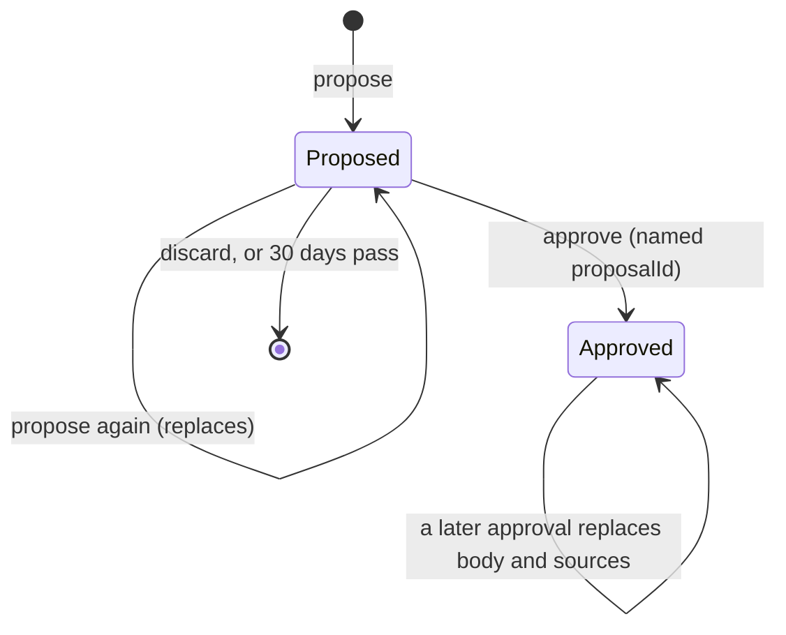

# Data model: Per-artist voice and brand guide

Source of truth after implementation: `src/lib/server/core/schema.ts` and the generated migration in `drizzle/`. Rationale is in [research.md](research.md).

## `artist_guides` (new table)

| Column        | Type                          | Rules                                                                            |
| ------------- | ----------------------------- | -------------------------------------------------------------------------------- |
| `id`          | `integer` PK, identity always | The `proposalId` approve and discard name (R9).                                  |
| `artist_id`   | `text` NN                     | `REFERENCES artists(id)`.                                                        |
| `kind`        | `text` NN                     | `CHECK kind in ('voice', 'brand')`.                                              |
| `status`      | `text` NN                     | `CHECK status in ('proposed', 'approved')`.                                      |
| `body`        | `jsonb` NN                    | Voice: `{ rules: string[] }`. Brand: `{ statement, keep[], fix[], drop[] }`.     |
| `sources`     | `jsonb` NN                    | Proposed: `ProposalSources`. Approved: `SourceSummary` (below).                  |
| `proposed_at` | `timestamptz` NN              | When the proposal's inputs were read. Approved rows keep their proposal's value. |
| `approved_at` | `timestamptz` null            | `CHECK (status = 'approved') = (approved_at is not null)`.                       |

- **Unique** `artist_guides_slot` on `(artist_id, kind, status)`: at most one proposal and one approved version per artist and kind (FR-001).
- **Check** `artist_guides_sources_check`: `(status = 'proposed' and jsonb_typeof(sources->'uploads') = 'array') or (status = 'approved' and jsonb_typeof(sources->'uploads') = 'number')`. An approved row can't hold an upload list, so no video ID or title persists past approval (FR-004).
- **Index** `artist_guides_expiry_idx` on `(proposed_at) where status = 'proposed'`, for the daily delete.
- **RLS** (`ENABLE` + `FORCE`):
  - _Own_ below means `exists (select 1 from public.users u where u.uid = <principal> and u.active and u.artist_id = artist_id)`; _fresh_ means `(status = 'approved' or proposed_at > now() - interval '30 days')`.
  - `guides_read` `FOR SELECT TO soundboard_app USING` own and fresh.
  - `guides_insert` `FOR INSERT TO soundboard_app WITH CHECK` own and `status = 'approved'` and `proposed_at <= now() and proposed_at > now() - interval '30 days'`. The app inserts only approved rows; proposals go through the function below.
  - `guides_update` `FOR UPDATE TO soundboard_app USING` own and fresh, `WITH CHECK` the same as `guides_insert`. `USING` lets approve lock a fresh proposal (`FOR UPDATE`); `WITH CHECK` lets only approved rows be written.
  - `guides_delete` `FOR DELETE TO soundboard_app USING` own and `status = 'proposed'` (and fresh, through the read policy). Nothing in the app deletes an approved row.
  - `guides_cleanup_read` (`FOR SELECT`) and `guides_cleanup_delete` (`FOR DELETE`) `TO soundboard_cleanup`, `USING status = 'proposed' and proposed_at <= now() - interval '30 days'`.
- **Grants:**
  - `soundboard_app`: `SELECT`, `INSERT (artist_id, kind, status, body, sources, proposed_at, approved_at)`, `UPDATE (body, sources, proposed_at, approved_at)`, `DELETE`, and `EXECUTE` on `soundboard_save_proposal`.
  - `soundboard_cleanup`: `SELECT (id, status, proposed_at)`, `DELETE`.

### Function `soundboard_save_proposal(p_kind text, p_body jsonb, p_sources jsonb) RETURNS SETOF public.artist_guides`

- `SECURITY DEFINER`, `SET search_path = pg_catalog, public`, `REVOKE ALL … FROM PUBLIC`, `EXECUTE` only to `soundboard_app`. Same pattern as `soundboard_save_audience` (0004).
- Locks the caller's active `users` row (`app.user_sub`) `FOR UPDATE`, so two proposes by one user serialize. Raises `42501` when there's no such user or it has no `artist_id`.
- Deletes the artist's `proposed` row of `p_kind`, of any age, then inserts the new one with `proposed_at = now()` and returns it.
- **Why a function:** under RLS, an `INSERT … ON CONFLICT DO UPDATE` that meets an expired (hidden) proposal raises instead of replacing it, and the app can't delete a row it can't see. Expired rows live up to a day before the daily delete, so a plain upsert would fail in that window. The function replaces them, as `soundboard_save_audience` refreshes expired research.

### `sources` shapes

- **`ProposalSources`** (pending only; expires with the row):
  - `uploads: { videoId: string; title: string; publishedAt: string }[]`: the artist's own uploads the proposal read, newest first.
  - `edits: number`: EDITED title or description rows read (voice only; 0 for brand).
  - `approvals: number`: ACCEPTED rows read (voice only; 0 for brand).
  - `thin: boolean`: voice only (R5); false for brand.
- **`SourceSummary`** (approved):
  - `uploads: number`, `edits: number`, `approvals: number`: counts copied from the proposal.
  - `carriedOver: boolean`: true only for rows the migration created from Nathan's earlier rules.

### State and lifecycle

- **Propose:** `soundboard_save_proposal`. Every proposal is a new row with a new `id`, so a tab holding the old `id` can't approve or discard the new one (R9). Two concurrent proposes serialize on the caller's `users` row: the later one wins, and neither hits a unique violation.
- **`proposed_at`** is always the database's `now()` at write, never an app value. It trails the YouTube read by under one step (110 s), which is inside the 30-day margin.
- **Approve:** lock the pending row, check `id`, then `INSERT … ON CONFLICT (artist_id, kind, status) DO UPDATE SET body, sources, proposed_at, approved_at` for the approved row, and delete the proposal. Only those four columns change, so spec 006's column survives (R10).
- **Discard:** lock, check `id`, delete.
- **Expire:** invisible to the app at 30 days; deleted by the daily job.
- **Nothing deletes an approved row.** It's replaced only by approval (US4 AS2).

## `artist_memory` (changed)

- `kind` enum and `artist_memory_kind_check` drop `brand`. The migration deletes every `brand` row after copying the approved one (R2, R3).
- Feedback rows are unchanged and are the voice evidence (spec Key Entities).

## `artists` (changed)

- `curated` is dropped after the migration uses it to find Nathan's row (R2).

## Migration data block (R3)

Runs after `CREATE TABLE artist_guides` and before `DROP COLUMN curated`:

1. Insert Nathan's approved voice:
   - `INSERT INTO artist_guides (artist_id, kind, status, body, sources, proposed_at, approved_at) SELECT id, 'voice', 'approved', <body>, '{"uploads":0,"edits":0,"approvals":0,"carriedOver":true}', now(), now() FROM artists WHERE curated`
   - `<body>` = `{"rules": [the 8 ARTIST_VOICE rules, then the credit rule]}` (research R2).
   - Wrapped in a `DO` block that raises unless exactly 1 row was inserted.
2. Copy his approved brand guide:
   - `INSERT … SELECT artist_id, 'brand', 'approved', data - 'status' - 'uploadCount' - 'createdAt' - 'approvedAt', jsonb_build_object('uploads', (data->>'uploadCount')::int, 'edits', 0, 'approvals', 0, 'carriedOver', true), to_timestamp((data->>'createdAt')::bigint / 1000.0), to_timestamp((data->>'approvedAt')::bigint / 1000.0) FROM artist_memory WHERE kind = 'brand' AND key = 'approved' ON CONFLICT DO NOTHING`
3. `DELETE FROM artist_memory WHERE kind = 'brand'`.

## TypeScript shapes

In `src/lib/brand.ts` (shared with the page):

- `VoiceRules = { rules: string[] }`, `VOICE_RULES_MAX = 12`, `VOICE_RULE_MAX = 240`, `VOICE_UPLOADS = 30`.
- `voiceError(voice: VoiceRules): string | null`: "Add at least one voice rule.", "Voice has more than 12 rules.", "A voice rule is over 240 characters."
- `BrandGuide` unchanged. `StoredBrand` is replaced by:
  - `GuideKind = 'voice' | 'brand'`
  - `Proposal<B> = { id: number; body: B; sources: ProposalSources; proposedAt: string }`
  - `Approved<B> = { body: B; sources: SourceSummary; proposedAt: string; approvedAt: string }`
  - `GuideState<B> = { approved: Approved<B> | null; proposal: Proposal<B> | null }`

In `src/lib/server/artist/guides.ts` (new):

- `getGuides(artistId)`: both kinds, for the page.
- `approvedGuides(artistId)`: `{ voice: VoiceRules | null; brand: BrandGuide | null }`, for the pick.
- `saveProposal(kind, body, sources)` (calls `soundboard_save_proposal`), `approveGuide(artistId, kind, proposalId, body)`, `discardProposal(artistId, kind, proposalId)`.

In `src/lib/server/ai/smart-pick.ts`:

- `PickContext.artist` becomes `{ name; contactLine }` (004's `curated` removed); `PickContext.voice: VoiceRules | null` added. `brand` unchanged.
- `ARTIST_VOICE` and 004's curated credit block are deleted.

In `src/lib/server/core/tracing.ts` and `ai/model.ts`: `AgentName` gains `'voice-guide'`.

## Spec 006 attach point (FR-012)

- The approved `brand` row. 006 adds `influence jsonb` with `CHECK (influence is null or (kind = 'brand' and status = 'approved'))`. 005 adds nothing (research R10).
