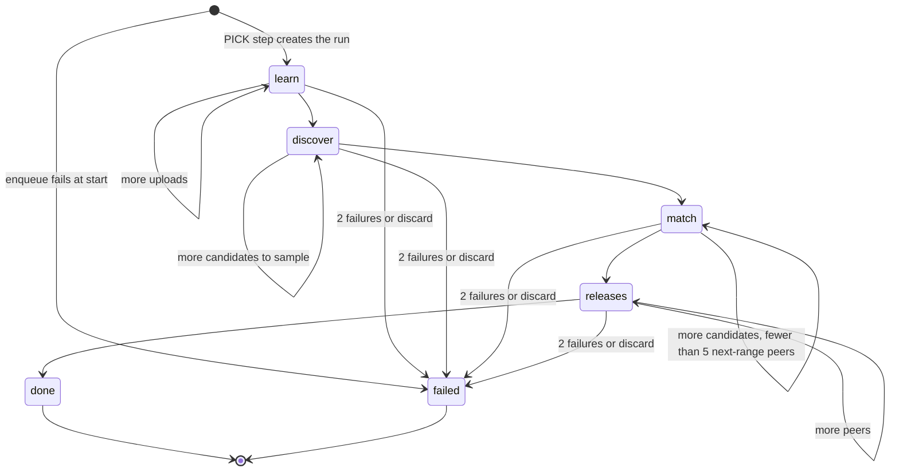

# Data model: Learn what grows the fanbase

Source of truth after implementation: `src/lib/server/core/schema.ts` and the generated migration in `drizzle/`. Rationale is in [research.md](research.md).

- _Principal_ means `nullif(current_setting('app.user_sub', true), '')`.
- _Active_ means `exists (select 1 from public.users u where u.uid = <principal> and u.active)`.
- _Own artist_ means `exists (select 1 from public.users u where u.uid = <principal> and u.active and u.artist_id = <table>.artist_id)`, with the column table-qualified (`${t.artistId}`), as 005 requires.
- _Shared now_ means `exists (select 1 from public.connections c where c.uid = <principal> and c.status = 'connected' and c.scopes @> '{https://www.googleapis.com/auth/yt-analytics.readonly}')`.
- _Fresh_ means `retrieved_at > now() - interval '29 days'`; _expired_ is its negation. 29 days, so the daily delete always lands before day 30 (R10).
- _Claim held_ (inside a write function) means `exists (select 1 from public.research_runs r join public.jobs j on j.id = r.job_id where r.id = p_run and r.claim_token = p_token and r.claim_until > now() and r.owner_uid = <principal> and j.state <> 'DISCARDED')`, locked `FOR UPDATE OF r`. Not held → raise `55000` ("Research claim lost").
- Every new table has `ENABLE` and `FORCE ROW LEVEL SECURITY`. Every function is `LANGUAGE plpgsql SECURITY DEFINER`, `SET search_path = pg_catalog, public`, `REVOKE ALL … FROM PUBLIC`, `EXECUTE` only to `soundboard_app`.

## `research_runs` (new): run state, no YouTube data

| Column                 | Type               | Rules                                                                                                  |
| ---------------------- | ------------------ | ------------------------------------------------------------------------------------------------------ |
| `job_id`               | `text` PK          | `REFERENCES jobs(id) ON DELETE CASCADE`. One run per job; a new run replaces the row.                  |
| `id`                   | `text` NN unique   | Random per run (`randomBytes(12).toString('base64url')`); prefixes task names and keys `job_research`. |
| `owner_uid`            | `text` NN          | `REFERENCES users(uid)`.                                                                               |
| `artist_id`            | `text` NN          | `REFERENCES artists(id)`.                                                                              |
| `stage`                | `text` NN          | `CHECK stage in ('learn','discover','match','releases','done','failed')`                               |
| `seq`                  | `integer` NN       | default 0; +1 per commit (R2).                                                                         |
| `cursor`               | `integer` NN       | default 0; next item in the current stage; reset to 0 when the stage advances.                         |
| `claim_token`          | `text` null        | Set by the claim, cleared by the commit.                                                               |
| `claim_until`          | `timestamptz` null | Claim + 3 minutes.                                                                                     |
| `consecutive_failures` | `integer` NN       | default 0; 2 → `failed`.                                                                               |
| `wait`                 | `text` null        | The last wait.                                                                                         |
| `error`                | `text` null        | Scrubbed message, or `research-unavailable` or `discarded`. Never a token or URL query.                |
| `limits`               | `text[]` NN        | default `{}`; codes from `RESEARCH_LIMITS`.                                                            |
| `started_at`           | `timestamptz` NN   | default `now()`.                                                                                       |
| `updated_at`           | `timestamptz` NN   | Every claim and commit.                                                                                |
| `finished_at`          | `timestamptz` null | Set with `done` or `failed`.                                                                           |

- **RLS** `runs_owner` `FOR ALL TO soundboard_app` (#6):
  - `USING`: `owner_uid = <principal> and <active>`
  - `WITH CHECK`: `owner_uid = <principal> and exists (select 1 from public.jobs j join public.users u on u.uid = <principal> where j.id = research_runs.job_id and j.owner_uid = <principal> and u.active and u.artist_id = research_runs.artist_id)`. A run for another user's job, or with an artist that isn't the caller's, is refused.
- **Grants:** `soundboard_app`: `SELECT`, `INSERT`, `DELETE`, `UPDATE (id, stage, seq, cursor, claim_token, claim_until, consecutive_failures, wait, error, limits, started_at, updated_at, finished_at)`.
- **`RESEARCH_LIMITS`:** `research-unavailable`, `research-unfinished`, `analytics-not-shared`, `youtube-not-connected`, `private-releases`, `few-peers`, `no-peers`, `hearing-off`, `same-range-fallback`, `artist-range-unknown`, `peer-range-unknown`, `secondary-only`.

## `job_research` (new): peer evidence, Non-Authorized Data, 29 days

| Column         | Type             | Rules                                                                                                                   |
| -------------- | ---------------- | ----------------------------------------------------------------------------------------------------------------------- |
| `run_id`       | `text` PK        | The run's `id`. Not a foreign key: a replaced run keeps its evidence until expiry, so old citations still resolve (#7). |
| `job_id`       | `text` NN        | `REFERENCES jobs(id) ON DELETE CASCADE`.                                                                                |
| `retrieved_at` | `timestamptz` NN | The run's first peer read. Never extended.                                                                              |
| `evidence`     | `jsonb` NN       | `PeerEvidence` (below).                                                                                                 |

- **Index** on `retrieved_at`; on `job_id`.
- **RLS:** `research_read` `FOR SELECT TO soundboard_app USING` fresh and `exists (select 1 from public.jobs j where j.id = job_research.job_id and j.owner_uid = <principal>)` and _active_. `research_cleanup_read` and `research_cleanup_delete` `TO soundboard_cleanup USING` expired.
- **Writes** only through `soundboard_save_research(p_run text, p_token text, p_at timestamptz, p_evidence jsonb)`: _claim held_; refuses `p_at` in the future or already expired; upserts by `run_id` with `job_id` from the run and `retrieved_at = coalesce(existing, p_at)`.
- **Grants:** `soundboard_app` `SELECT`, `EXECUTE`. `soundboard_cleanup` `SELECT (run_id, retrieved_at)`, `DELETE`.

## `artist_outcomes` (new): the artist's own results, Authorized Data, 29 days

| Column                  | Type             | Rules                                                                                |
| ----------------------- | ---------------- | ------------------------------------------------------------------------------------ |
| `artist_id`             | `text` NN        | `REFERENCES artists(id)`                                                             |
| `video_id`              | `text` NN        | The artist's own upload.                                                             |
| `retrieved_at`          | `timestamptz` NN | Set by the save.                                                                     |
| `published_at`          | `timestamptz` NN | `snippet.publishedAt`.                                                               |
| `requested_start`       | `date` NN        | Pacific date of `published_at`.                                                      |
| `requested_end`         | `date` NN        | `requested_start + 27`, capped at today's Pacific date.                              |
| `coverage`              | `text` NN        | `CHECK coverage in ('open','complete','unknown')` (R8, #14).                         |
| `metrics`               | `jsonb` NN       | `{ views, subscribersGained, subscribersLost }`, each a number or null, as reported. |
| `live`                  | `jsonb` NN       | `{ title, description (≤ 700), tags }` read back at learning time.                   |
| `differs_from_approved` | `boolean` null   | null when no publish record matches. Compared on full values before clipping.        |

- **PK** `(artist_id, video_id)`: a revised report replaces the row (FR-010).
- **RLS:** `outcomes_read` `FOR SELECT TO soundboard_app USING` own artist and fresh and _shared now_ (#4). `outcomes_cleanup_read` and `outcomes_cleanup_delete` `TO soundboard_cleanup USING` expired.
- **Writes** only through `soundboard_save_outcomes(p_run text, p_token text, p_grant_at timestamptz, p_rows jsonb)` (#4, #5):
  1. _claim held_
  2. `SELECT 1 FROM connections WHERE uid = <principal> AND status = 'connected' AND scopes @> '{…yt-analytics.readonly}' AND updated_at = p_grant_at FOR SHARE`; not found → raise `28000`, nothing written
  3. the caller's `artist_id` from the active `users` row (else `42501`); delete their rows for the given video IDs (expired included); insert with `retrieved_at = now()`
- **Grants:** `soundboard_app` `SELECT`, `EXECUTE`. `soundboard_cleanup` `SELECT (artist_id, video_id, retrieved_at)`, `DELETE`.

## `peer_rejections` (new): "Not a peer", channel IDs, 29 days unless refreshed

| Column         | Type             | Rules                                                 |
| -------------- | ---------------- | ----------------------------------------------------- |
| `artist_id`    | `text` NN        | `REFERENCES artists(id)`                              |
| `channel_id`   | `text` NN        | The rejected peer's channel.                          |
| `retrieved_at` | `timestamptz` NN | Set on reject; refreshed at each discover stage (R4). |

- **PK** `(artist_id, channel_id)`.
- **RLS:** `rejections_read` `FOR SELECT TO soundboard_app USING` own artist and fresh. Cleanup policies as above.
- **Writes:**
  - `soundboard_reject_peer(p_channel text)`: the caller's active `users` row with an `artist_id` (else `42501`); insert or refresh. A user action, so no run claim.
  - `soundboard_refresh_rejections(p_run text, p_token text, p_kept text[], p_gone text[])`: _claim held_; refresh kept, delete gone, for the caller's artist.
- **Grants:** `soundboard_app` `SELECT`, `EXECUTE` on both. `soundboard_cleanup` `SELECT (artist_id, channel_id, retrieved_at)`, `DELETE`.

## `artist_guides` (changed by 006)

- **Add** `influence jsonb` null.
- `CHECK (influence is null or (kind = 'brand' and status = 'approved'))`.
- `CHECK (influence is null or public.soundboard_influence_ok(influence))`: an `IMMUTABLE` SQL function, true for an object with exactly the keys `sound`, `feel`, `wording`, `discovery`, `structure`, each a JSON number that is an integer 0–4. Created before the check.
- **Writes** through `soundboard_save_influence(p_influence jsonb) RETURNS integer` (rows updated): locks the caller's `users` row and updates `influence` on their `kind = 'brand' and status = 'approved'` row only. Never `body`, `sources`, `proposed_at` or `approved_at`.
- 005's approve upsert sets only its four columns, so `influence` survives re-approval.

## `connections` (no new column; new trigger)

- "Analytics shared" = `status = 'connected' and scopes @> '{https://www.googleapis.com/auth/yt-analytics.readonly}'`. The app reads it through `analyticsShared` in `platforms/youtube/`.
- **Trigger** `connections_forget_outcomes` `AFTER DELETE OR UPDATE OF status, scopes, updated_at ON connections FOR EACH ROW` → `public.soundboard_forget_outcomes()`. When the old row was shared and the new row isn't (deleted, not `connected`, or missing the scope), it deletes `artist_outcomes` for the user's `artist_id` (III.D.2.c). Disconnect, `markRevoked` and a reconnect that drops the scope all take this path.

## `jobs.picks` and `artist_memory` publishes (JSON shapes changed)

- **`Pick`** gains:
  - `influence: Influence` (FR-023)
  - `citations: Record<Role, string[]>`
  - `recommendation: Recommendation | null`: null on Shorts, on picks made before 006, and when only secondary evidence supported it
  - `influenceWarning: string | null`
  - `researchRunId: string | null`: the `job_research.run_id` its `P*` refs resolve against
  - `evidenceExpiresAt: string | null`: `retrieved_at + 29 days`, so an expired citation can still show its date (#7)
  - `outcomeRefs: Record<string, string>`: `A<n>` → the artist's own video ID
- **`Publish` record** (`artist_memory` kind `publish`) gains `recommendation: { approach, intendedOutcome, evidence: string[] } | null`, `influence: Influence | null`, `editedBeforeApproval: boolean`. Its `fields` (approved) are unchanged. No YouTube data: refs only.

## Retention job

`handleGenreCleanup` runs, as `soundboard_cleanup`, after 005's two deletes:

```sql
delete from job_research where retrieved_at <= now() - interval '29 days' returning run_id;
delete from artist_outcomes where retrieved_at <= now() - interval '29 days' returning video_id;
delete from peer_rejections where retrieved_at <= now() - interval '29 days' returning channel_id;
```

Response: `{ deleted, proposals, research, outcomes, rejections }`. Any failure → 500.

## TypeScript shapes

- `src/lib/influence.ts` (shared with the page): `ROLES`, `Role`, `Influence = Record<Role, 0|1|2|3|4>`, `DEFAULT_INFLUENCE = { sound: 1, feel: 0, wording: 0, discovery: 4, structure: 4 }`, `influenceError(value): string | null`.
- `src/lib/types.ts`: `Recommendation = { approach; intendedOutcome; follows: 'artist'|'peers'|'both'|'none'; followsWhy; evidence: string[]; limits: string[] }`; `Wait` gains `'researching similar artists'`; `Calculated = { value: number | null; calculated: true }`.
- `src/lib/server/research/evidence.ts`:
  - `PeerEvidence = { query; artist: { stats: ChannelStatsReported; bracket: Bracket | null }; candidates: Candidate[]; peers: Peer[]; releases: PeerRelease[]; skipped: { channelId; reason }[] }`
  - `Peer = { ref; channelId; title; basis: 'heard'|'metadata-only'; explanation; stats: ChannelStatsReported; bracket: Bracket | null; relation: 'same'|'next'|'two-up'|null; secondary: boolean }`
  - `PeerRelease = { ref; peer; videoId; title; description; tags; hashtags; durationSec; publishedAt; stats: { views; likes; comments }; selectedAs: 'newest'|'most-viewed'|'most-engaged' }`, statistics each a number or null as reported
  - `ChannelStatsReported = { subscribers: number | null; hidden: boolean; videos: number | null; views: number | null }`
  - `Bracket` = the lower bound of a decade range (`0 | 100 | 1000 | 10000 | 100000 | 1000000`)
- `src/lib/server/research/runs.ts`: `ResearchRun`, `RunStage`, `Delivery = { jobId; uid; runId; seq }`.

## State: a research run



- A wait keeps the stage and cursor and schedules the next delivery (R2).
- `done` with no peers is still `done`; the limits say why.
- A pick after the run expires, or after it failed, replaces the row: new `id`, `seq` 0, stage `learn`. The old evidence row stays until it expires.
