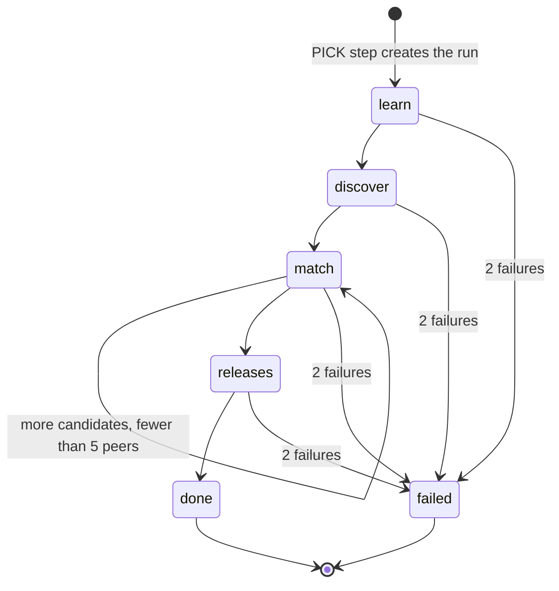

# Data model: Learn what grows the fanbase

Source of truth after implementation: `src/lib/server/core/schema.ts` and the generated migration in `drizzle/`. Rationale is in [research.md](research.md).

- _Principal_ below means `nullif(current_setting('app.user_sub', true), '')`.
- _Active_ means `exists (select 1 from public.users u where u.uid = <principal> and u.active)`.
- _Own artist_ means `exists (select 1 from public.users u where u.uid = <principal> and u.active and u.artist_id = <row>.artist_id)`.
- _Fresh_ means `retrieved_at > now() - interval '30 days'`; _expired_ is its negation.
- Every new table has `ENABLE` and `FORCE ROW LEVEL SECURITY`.

## `research_runs` (new): run state, no YouTube data

| Column                 | Type               | Rules                                                                                         |
| ---------------------- | ------------------ | --------------------------------------------------------------------------------------------- |
| `job_id`               | `text` PK          | `REFERENCES jobs(id) ON DELETE CASCADE`. One run per job; a new run after expiry replaces it. |
| `id`                   | `text` NN unique   | Random per run (`randomBytes(12).toString('base64url')`); prefixes task names (R2).           |
| `owner_uid`            | `text` NN          | `REFERENCES users(uid)`; equals the job's owner.                                              |
| `artist_id`            | `text` NN          | `REFERENCES artists(id)`; the job's artist.                                                   |
| `stage`                | `text` NN          | `CHECK stage in ('learn','discover','match','releases','done','failed')`                      |
| `seq`                  | `integer` NN       | default 0; +1 per release (R2).                                                               |
| `claim_token`          | `text` null        | Set by the claim, cleared by the release.                                                     |
| `claim_until`          | `timestamptz` null | Claim + 3 minutes.                                                                            |
| `consecutive_failures` | `integer` NN       | default 0; 2 → `failed`.                                                                      |
| `wait`                 | `text` null        | The last wait, shown on the working screen.                                                   |
| `error`                | `text` null        | Scrubbed message (`scrubUrl`), never a token or URL query.                                    |
| `limits`               | `text[]` NN        | default `{}`; codes from `RESEARCH_LIMITS` (below).                                           |
| `cursor`               | `integer` NN       | default 0; next candidate index in `match`.                                                   |
| `started_at`           | `timestamptz` NN   | default `now()`.                                                                              |
| `updated_at`           | `timestamptz` NN   | Every claim and release.                                                                      |
| `finished_at`          | `timestamptz` null | Set with `done` or `failed`.                                                                  |

- **RLS** `runs_owner` `FOR ALL TO soundboard_app`: `owner_uid = <principal> and <active>`, both `USING` and `WITH CHECK`.
- **Grants:** `soundboard_app`: `SELECT`, `INSERT`, `DELETE`, `UPDATE (id, stage, seq, claim_token, claim_until, consecutive_failures, wait, error, limits, cursor, started_at, updated_at, finished_at)`.
- **`RESEARCH_LIMITS`:** `analytics-not-shared`, `youtube-not-connected`, `private-releases`, `few-peers`, `no-peers`, `hearing-off`, `same-range-fallback` (flag on only), `research-unfinished` (set by the pick, R3).

## `job_research` (new): peer evidence, Non-Authorized Data, 30 days

| Column         | Type             | Rules                                                                            |
| -------------- | ---------------- | -------------------------------------------------------------------------------- |
| `job_id`       | `text` PK        | `REFERENCES jobs(id) ON DELETE CASCADE`                                          |
| `retrieved_at` | `timestamptz` NN | The run's first YouTube read. Never extended by later stages, retries or Shorts. |
| `evidence`     | `jsonb` NN       | `PeerEvidence` (below).                                                          |

- **Index** on `retrieved_at`.
- **RLS:** `research_read` `FOR SELECT TO soundboard_app USING` fresh and `exists (select 1 from public.jobs j where j.id = job_id and j.owner_uid = <principal>)` and _active_. `research_cleanup_read` and `research_cleanup_delete` `TO soundboard_cleanup USING` expired.
- **Writes** only through `soundboard_save_research(p_job text, p_at timestamptz, p_evidence jsonb)`. It's `SECURITY DEFINER`, copied from `soundboard_save_audience` (0004): it checks the caller owns the job, refuses `p_at` in the future or already expired, deletes any row for the job (an expired one included), and inserts. The app gets no direct write grant.
- **Grants:** `soundboard_app` `SELECT`, `EXECUTE` on the function. `soundboard_cleanup` `SELECT (job_id, retrieved_at)`, `DELETE`.

## `artist_outcomes` (new): the artist's own results, Authorized Data, 30 days

| Column                  | Type             | Rules                                                                                |
| ----------------------- | ---------------- | ------------------------------------------------------------------------------------ |
| `artist_id`             | `text` NN        | `REFERENCES artists(id)`                                                             |
| `video_id`              | `text` NN        | The artist's own upload.                                                             |
| `retrieved_at`          | `timestamptz` NN | The learn stage's read; refreshed every learn stage.                                 |
| `published_at`          | `timestamptz` NN | From `snippet.publishedAt`.                                                          |
| `period_start`          | `date` NN        | The publish date.                                                                    |
| `period_end`            | `date` NN        | `period_start + 27`, capped at the report date.                                      |
| `partial`               | `boolean` NN     | The 28-day window is still open.                                                     |
| `metrics`               | `jsonb` NN       | `{ views, subscribersGained, subscribersLost }`, each a number or null, as reported. |
| `live`                  | `jsonb` NN       | `{ title, description (≤ 700), tags }` read back at learning time.                   |
| `differs_from_approved` | `boolean` null   | null when no publish record matches.                                                 |

- **PK** `(artist_id, video_id)`: a revised report replaces the row (FR-010).
- **RLS:** `outcomes_read` `FOR SELECT TO soundboard_app USING` own artist and fresh. `outcomes_cleanup_read` and `outcomes_cleanup_delete` `TO soundboard_cleanup USING` expired. Revocation deletes through the `connections` trigger (below), not an app grant.
- **Writes** only through `soundboard_save_outcomes(p_rows jsonb)`, `SECURITY DEFINER`: it locks the caller's active `users` row, takes their `artist_id` (else `42501`), deletes their rows for the given video IDs (expired included), and inserts with `retrieved_at = now()`.
- **Grants:** `soundboard_app` `SELECT`, `EXECUTE`. `soundboard_cleanup` `SELECT (artist_id, video_id, retrieved_at)`, `DELETE`.

## `peer_rejections` (new): "Not a peer", channel IDs, 30 days unless refreshed

| Column         | Type             | Rules                                                 |
| -------------- | ---------------- | ----------------------------------------------------- |
| `artist_id`    | `text` NN        | `REFERENCES artists(id)`                              |
| `channel_id`   | `text` NN        | The rejected peer's channel.                          |
| `retrieved_at` | `timestamptz` NN | Set on reject; refreshed at each discover stage (R4). |

- **PK** `(artist_id, channel_id)`.
- **RLS:** `rejections_read` `FOR SELECT TO soundboard_app USING` own artist and fresh. Cleanup policies as above.
- **Writes** through `soundboard_reject_peer(p_channel text)` (insert or refresh for the caller's artist) and `soundboard_refresh_rejections(p_kept text[], p_gone text[])` (refresh the kept rows, delete the gone ones). Both `SECURITY DEFINER` with the `users` lock.
- **Grants:** `soundboard_app` `SELECT`, `EXECUTE` on both. `soundboard_cleanup` `SELECT (artist_id, channel_id, retrieved_at)`, `DELETE`.

## `artist_guides` (changed by 006)

- **Add** `influence jsonb` null.
- `CHECK (influence is null or (kind = 'brand' and status = 'approved'))`.
- `CHECK (influence is null or (jsonb_typeof(influence) = 'object' and (select count(*) from jsonb_object_keys(influence)) = 5 and <each of sound, feel, wording, discovery, structure is an integer 0–4>))`. A `CHECK` can't hold a subquery, so this is written as an immutable helper `public.soundboard_influence_ok(jsonb)` called by the check.
- **Writes** through `soundboard_save_influence(p_influence jsonb) RETURNS integer` (rows updated), `SECURITY DEFINER`. It locks the caller's `users` row and updates `influence` on their `kind = 'brand' and status = 'approved'` row only. It never touches `body`, `sources`, `proposed_at` or `approved_at`.
- 005's approve upsert sets only its four columns, so `influence` survives re-approval (005 R10).

## `connections` (no new column; new trigger)

- `scopes` already stores the granted list. "Analytics shared" = `status = 'connected' and scopes @> '{https://www.googleapis.com/auth/yt-analytics.readonly}'` (R9).
- **Trigger** `connections_forget_outcomes` `AFTER DELETE OR UPDATE OF status, scopes ON connections FOR EACH ROW` → `public.soundboard_forget_outcomes()`, `SECURITY DEFINER`. When the old row was shared and the new row isn't (deleted, not `connected`, or missing the scope), it deletes `artist_outcomes` for the user's `artist_id` (III.D.2.c).
  - One rule for every path: Disconnect (`revokeGrant`), refusal (`markRevoked`), and a reconnect that drops the scope.
  - The platform code needs no knowledge of artist tables (constitution IV).

## `jobs.picks` and `artist_memory` publishes (JSON shapes changed)

- **`Pick`** gains:
  - `influence: Influence`: the settings used (FR-023)
  - `citations: Record<Role, string[]>`: validated refs (R12)
  - `recommendation: Recommendation | null`: null on picks made before 006 and on Shorts
  - `influenceWarning: string | null`
  - `researchJobId: string | null`: the `job_research` row its `P*` refs resolve against (the job itself, or null with no peers)
  - `outcomeRefs: Record<string, string>`: `A<n>` → the artist's own video ID, the same kind of ID publish records already keep. Review resolves a ref against fresh `artist_outcomes`; an expired or deleted one shows as expired
- **`Publish` record** (`artist_memory` kind `publish`) gains `recommendation: { approach, intendedOutcome, evidence: string[] } | null` and `influence: Influence | null` (FR-007). No YouTube data: refs only.

## Retention job

`handleGenreCleanup` runs, as `soundboard_cleanup`, after 005's two deletes:

```sql
delete from job_research where retrieved_at <= now() - interval '30 days' returning job_id;
delete from artist_outcomes where retrieved_at <= now() - interval '30 days' returning video_id;
delete from peer_rejections where retrieved_at <= now() - interval '30 days' returning channel_id;
```

Response: `{ deleted, proposals, research, outcomes, rejections }`. Any failure → 500, as today.

## TypeScript shapes

- `src/lib/influence.ts` (shared with the page):
  - `ROLES = ['sound','feel','wording','discovery','structure'] as const`, `Role`
  - `Influence = Record<Role, 0|1|2|3|4>`
  - `DEFAULT_INFLUENCE = { sound: 1, feel: 0, wording: 0, discovery: 4, structure: 4 }`
  - `influenceError(value): string | null`
- `src/lib/types.ts`:
  - `Recommendation = { approach; intendedOutcome; follows: 'artist'|'peers'|'both'|'none'; followsWhy; evidence: string[]; limits: string[] }`
  - `Wait` gains `'researching similar artists'`
- `src/lib/server/research/evidence.ts`:
  - `PeerEvidence = { query; candidates: Candidate[]; peers: Peer[]; releases: PeerRelease[]; skipped: { channelId; reason }[] }`
  - `Peer = { ref; channelId; title; basis: 'heard'|'metadata-only'; explanation; stats: ChannelStatsReported; bracket: 'same'|'next'|'two-up'|null }`
  - `PeerRelease = { ref; peer; videoId; title; description; tags; hashtags; durationSec; publishedAt; stats: { views; likes; comments } }`, each a number or null as reported
  - `ChannelStatsReported = { subscribers: number | null; hidden: boolean; videos: number | null; views: number | null }`
- `src/lib/server/research/runs.ts`: `ResearchRun` (row), `RunStage`, `Delivery = { jobId; uid; runId; seq }`.

## State: a research run



- A wait keeps the stage and schedules the next delivery (R2).
- `done` with no peers is still `done`; the limits say why.
- A pick after the evidence expires replaces the row: new `id`, `seq` 0, stage `learn`.
